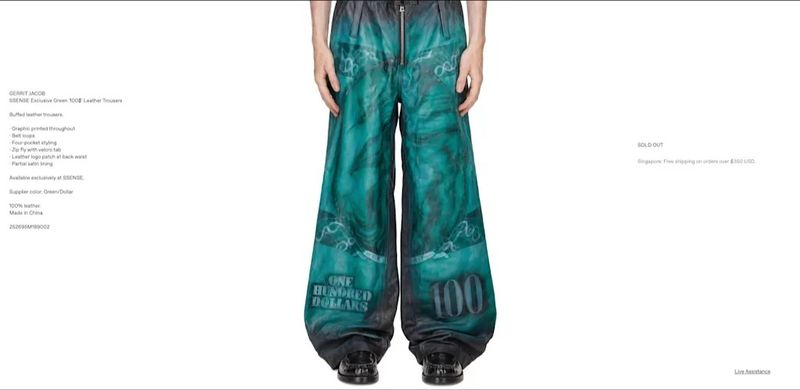

# Fashion news digest – 22 November 2026

## Top of the night

1. SSENSE confirms some product photos came from virtual try-on tech after Reese Cooper and Gerrit Jacob flag distorted garments: AI imagery's fidelity problem goes mainstream.
2. Paolo Bulgari, the gemstone expert who chaired the Roman jeweller from 1984, dies at 89.
3. AI scrutiny spreads to luxury campaigns (Dior's interpolated animation) while retailers report AI assistants converting at 2x (Target).

## Fashion tech & AI

### 1. SSENSE admits some product photos came from virtual try-on tech after designers flag distorted garments

Designers Reese Cooper (RCOS) and Gerrit Jacob called out SSENSE on Instagram for product images that warped details of their pieces, such as an oversized hook and altered embroidery and zips on an RCOS puffer. Per The New York Times (via Quartz), an SSENSE spokeswoman said some site photos are produced with virtual try-on technology and confirmed layoffs in its visuals team over the summer, but would not say whether the tool uses AI. Complex Style reports the affected products were pulled from the site. The Fader traces the shift back to July reports that SSENSE cut most of its photo team after its 2025 creditor-protection filing.

**Why it matters for On-Model/PiktID:** The clearest public case yet that garment fidelity, not just realism, decides whether AI on-model imagery helps or hurts a retailer and its brands: exactly On-Model's quality bar.

[Full resolution (Drive)](https://drive.google.com/file/d/1_1y9w9jJEt8LaSD3MvfS8cHKqbubtgak/view) · [Source image](https://thefader-res.cloudinary.com/private_images/c_limit,w_1024/c_crop,h_1870,w_3420,x_0,y_88,f_auto,q_auto:eco/Screenshot_2026-11-19_at_3.30.20_PM_eugnp0/Screenshot_2026-11-19_at_3.30.20_PM_eugnp0.jpg) · image credit: source outlet, internal reference only

Sources: [qz.com](https://qz.com/ssense-virtual-try-on-designers-images-112026) · [thefader.com](https://www.thefader.com/2026/11/19/ssense-ai-product-photos-explainer) · [complex.com](https://www.complex.com/style/a/alex-ocho/reese-cooper-ssense-ai-product-images) · [x.com](https://x.com/ComplexStyle/status/2123409047864906149)

Influence score: 9/10 · Engagement seen: x complexstyle views: 4,701, x complexstyle likes: 31, x complexstyle reposts: 3 · Published: 2026-11-20

### 3. Dior's hand-drawn-style holiday film draws fire after director confirms AI interpolation

Dior's Autumn-Winter 26/27 animated campaign by Sylvain Chomet was pitched as a return to traditional animation, but viewers spotted extra fingers, unstable faces and five-legged chairs. FashionNetwork reports Chomet told Variety he used AI interpolation to generate in-between frames, framing it as automating repetitive work rather than creative work. The piece sets it against Prada's animated campaign and a wider luxury debate about AI and craft jobs.

**Why it matters for On-Model/PiktID:** Luxury audiences now audit campaigns frame by frame for AI artefacts; disclosure and consistency control matter as much as the output.

Sources: [ww.fashionnetwork.com](https://ww.fashionnetwork.com/news/Dior-prada-levi-s-why-are-animated-campaigns-sparking-controversy-amid-the-rise-of-ai-,1886266.html)

Influence score: 6/10 · Engagement seen: none visible · Published: 2026-11-18

### 5. AI wholesale platform Everful raises $48.5M Series A to scale in the US and Europe

Everful, founded by ex-Alibaba executive Sisi Song and Kevin Han (whose Orbeus was bought by Amazon), closed a $48.5M Series A led by Vertex Ventures Southeast Asia & India and January Capital, with Square Peg and Lightspeed. The marketplace says it ships over 5 million pieces a month across fashion, footwear and other categories to retailers in 60+ countries, from a network of 30,000+ factories and a 20M-item catalogue, and expects $100M annualised revenue by year-end. Funds go to US and European growth and its AI agents and fulfilment stack.

**Why it matters for On-Model/PiktID:** Sourcing is being rebuilt around AI catalogues with millions of SKUs, each needing sell-ready imagery fast: a scale use case for automated on-model content.

Sources: [wwd.com](https://wwd.com/sourcing-journal/industry-news/everful-raises-48-5-million-funding-round-ai-commerce-1239429533/)

Influence score: 6/10 · Engagement seen: none visible · Published: 2026-11-20

### 9. The Interline: AI agents may reshape product creation in the messy space PLM never covered

In an Interline podcast with VibeIQ's Brian Lindauer, the host argues AI makes a single source of product truth more vital, yet much of the work between a brand's plan and its execution still lives in Miro boards and spreadsheets. The episode explores how agents could take on that unstructured planning and merchandising work. No new articles were published on The Interline within tonight's window; this is its most recent piece not yet covered.

**Why it matters for On-Model/PiktID:** Upstream product data quality is what downstream AI imagery and try-on rely on; tools that structure it widen the integration surface for On-Model.

Sources: [theinterline.com](https://www.theinterline.com/2026/11/19/how-will-ai-agents-change-the-way-we-create-products-brian-lindauer-vibeiq/)

Influence score: 4/10 · Engagement seen: none visible · Published: 2026-11-19

## E-commerce & retail business

### 4. Target says shoppers using its Ask Target AI assistant buy at about twice the usual rate

On its Q3 call, Target CEO Michael Fiddelke said the beta of Ask Target, the retailer's AI shopping assistant launched in October, is converting customers at roughly double the rate seen elsewhere on its channels. He said more capabilities are coming in the next few months and positioned Target to stay ahead of shifts in how shoppers find products in the agentic-commerce era.

**Why it matters for On-Model/PiktID:** Conversational shopping that converts at 2x raises the value of rich, consistent product imagery that assistants can surface and show on-body.

[Full resolution (Drive)](https://drive.google.com/file/d/12PZXt_BI9saq9SSKZjUOrJCnPw1vJMvt/view) · [Source image](https://imgproxy.divecdn.com/q5V9BQKlDUQVgSXd6EC8LSvSMo8eUsxzvKLUHkKt5-I/g:ce/rs:fit:770:435/Z3M6Ly9kaXZlc2l0ZS1zdG9yYWdlL2RpdmVpbWFnZS9JTUdfMDc4MC5qcGc=.webp) · image credit: source outlet, internal reference only

Sources: [retaildive.com](https://www.retaildive.com/news/target-ai-shopping-assistant-drives-sales-q3/875106/)

Influence score: 6/10 · Engagement seen: none visible · Published: 2026-11-19

## Brands, launches & deals

### 2. Paolo Bulgari, the gem expert who helped build the modern Bulgari, dies in Rome at 89

Paolo Bulgari, grandson of founder Sotirio and chairman of the Roman jeweller since 1984, died in Rome; his family announced it on 21 November. He joined the house in 1960 and became known worldwide for his knowledge of gemstones, expanding the group internationally with his brother Nicola and nephew Francesco Trapani. LVMH, owner of Bulgari since 2011, paid tribute through Bernard Arnault, and Italian media and TikTok accounts (La Repubblica, Rai Radio 1) carried the news widely. The family called him "the greatest jeweller of our time" (Euronews translation).

Sources: [wwd.com](https://wwd.com/accessories-news/jewelry/paolo-bulgari-chairman-jewelry-roman-house-dies-rome-1239461393) · [it.euronews.com](https://it.euronews.com/2026/11/21/paolo-bulgari-gioielliere-e-imprenditore-italiano-muore-a-roma-a-89-anni) · [ilgiornale.it](https://www.ilgiornale.it/news/moda/e-morto-paolo-bulgari-limprenditore-della-maison-di-gioielli-aveva-89-anni/) · [tiktok.com](https://www.tiktok.com/@la.repubblica/video/7710618447339605281)

Influence score: 8/10 · Engagement seen: tiktok larepubblica likes: 27,800, tiktok larepubblica shares: 1,559, tiktok larepubblica comments: 88 · Published: 2026-11-21

### 7. Saint Laurent marks 60 years of Le Smoking with a star-heavy campaign that leads fashion search on X

Saint Laurent's winter campaign celebrates the tuxedo suit Yves Saint Laurent introduced for women in 1966, cast with Anok Yai, Charlotte Gainsbourg, Rosé, Zoë Kravitz, Kate Moss, Charli XCX, Rauw Alejandro and CORTIS members, among others. Nylon notes Anthony Vaccarello's updated cut with a longer jacket and roomier trouser. The brand's X post was the top result for 'fashion' on X tonight with about 134K views.

Sources: [nylon.com](https://www.nylon.com/fashion/saint-laurent-le-smoking-60-anniversary-campaign) · [x.com](https://x.com/YSL/status/2123429022860452009)

Influence score: 5/10 · Engagement seen: x ysl views: 134,299, x ysl likes: 6,090, x ysl reposts: 2,490, x ysl replies: 1,466 · Published: 2026-11-19

## Celebrity & red carpet

### 6. Marion Cotillard wears three Chanel looks in two days as Marrakech jury president

Leading the 2026 Marrakech International Film Festival jury, Marion Cotillard opened in a Chanel Spring 2027 dress with a sheer skirt and scattered star-like embellishment, worn with Chanel High Jewellery and black sandals. Her press-conference look paired an embellished plaid skirt with an oversized vest and metallic gold pumps, and on 21 November she wore a red Chanel Spring 2026 Haute Couture dress covered in black, grey and white feathers with silver pumps. Red Carpet Fashion Awards rates only the opening dress a full success. No photos stored; see the source.

Sources: [redcarpet-fashionawards.com](https://www.redcarpet-fashionawards.com/2026/11/22/marion-cotillards-chanel-looks-at-marrakech-go-from-elegant-to-eccentric/)

Influence score: 6/10 · Engagement seen: none visible · Published: 2026-11-22

### 8. Hailee Steinfeld goes sculptural in Harris Reed at the London premiere of 'Hexed'

At the 21 November European premiere of 'Hexed' in London, Hailee Steinfeld wore a Harris Reed look blending suiting and eveningwear: a rose-gold metallic jacket with exaggerated shoulders, black floral detailing and a nipped waist flaring at the hips, over a conical black skirt trimmed in the same metallic fabric. WWD links the padded-hip shape to 16th-17th century bum rolls. No photos stored; see the source.

Sources: [wwd.com](https://wwd.com/pop-culture/celebrity-news/hailee-steinfeld-harris-reed-hexed-european-premiere-1239461370)

Influence score: 5/10 · Engagement seen: none visible · Published: 2026-11-21

## Social trends (X/TikTok)

### 10. DIY garment hacks and sewing projects lead TikTok's Beauty & Style trending posts

*Unverified social claim (platform data only).*

In TikTok Studio's Inspiration view (Beauty & Style, all regions), the fashion-related posts trending tonight are hands-on: a memory-quilt commission (about 3.1M / 269K as shown), a creator shrinking an XXL sweater to fit while campaigning for TikTok Awards UK fashion creator of the year (1.5M / 112K), and sewing posts recreating dresses. Polished brand content did not appear in the category's top ten.

**Why it matters for On-Model/PiktID:** Process and fit transformation content outperforms polished visuals; On-Model before/after (flat-lay to on-model) clips fit that format.

Sources: [tiktok.com](https://www.tiktok.com/tiktokstudio/inspiration)

Influence score: 3/10 · Engagement seen: memory quilt post shown: 3.1M / 269K, xxl sweater post shown: 1.5M / 112K, metric note: pairs as displayed in TikTok Studio Inspiration (likely views / likes) · Published: 2026-11-22

## TikTok search insights

- Creator Search Insights' keyword and content-gap view isn't offered on TikTok web for this account, so no search-keyword or content-gap figures tonight. Used TikTok Studio > Inspiration > Trending (Beauty & Style, all regions) instead; figures are the pairs shown there (likely views / likes).

- memory quilt / #costuracreativa: 3.1M / 269K (as shown)
- #fashion #DIY (shrinking an XXL sweater): 1.5M / 112K (as shown)
- #fashion #design #sewing: 790K / 68K (as shown)
- #hairstyle: 1.8M / 22K (as shown)
- #skincare #facemask: 11M / 683K (as shown)

- Gap On-Model could fill: fashion entries in the trending set are DIY fit/transformation clips; no brand shows a flat-lay to on-model transformation in that format.

## Sources checked

- X: signed in. Home timeline (mostly tech/AI), Explore trending (Italy; no fashion topics), searches for fashion (Top), "fashion news" (Latest), "AI fashion", "virtual try-on", red carpet outfit, "fashion week", AMAs red carpet (no 2026 AMAs results).
- TikTok: signed in. For You, searches 'fashion news', 'AI fashion', 'red carpet outfit', 'paolo bulgari'.
- TikTok Creator Search Insights: unavailable on web (keyword/gap view); TikTok Studio Inspiration trending used.
- News: The Interline (no new posts since 20 Nov), Business of Fashion (paywalled; headlines only, not used for claims), Vogue Business, WWD, FashionUnited, Just Style, Sourcing Journal, Retail Dive, Modern Retail, TechCrunch, FashionNetwork, Quartz, The Fader, Complex, Euronews, Il Giornale, Nylon, Red Carpet Fashion Awards. Drapers unreachable (proxy error).
- Catch-ups: items 1, 3, 4, 7 and 9 were published 18-20 November but were not in earlier digests; SSENSE's confirmation (20 Nov) is the new development on that story.
- Not used: Louis Vuitton x Keith Haring (announced 13 Nov), H&M Design Award winner (19 Nov), Rebecca Minkoff sale (16 Nov), Tommy Hilfiger Shinsaibashi store (13 Nov) as outside the window; Meta Muse try-on (covered 21 Nov).
- Images: the workspace network blocks direct downloads, so images are browser renders at the size the source serves them; 2 uploaded to the [Drive day folder](https://drive.google.com/drive/folders/1zSgmcB63X8ip6gc3f3hKpcp9IB04seZb) and previewed here. No photos of real people stored (Bulgari, Everful and celebrity images skipped; Dior's animated still skipped as it may depict a real person).

## Possible LinkedIn angles

- SSENSE shows the real risk in AI product imagery isn't realism, it's fidelity: a wrong hook or zip turns into a brand complaint. How we measure garment accuracy.
- 'Hand-drawn' with AI in-betweens: Dior's campaign shows disclosure is now part of creative direction.
- AI assistants convert at 2x (Target): when the shopper's first view is chosen by an agent, every SKU needs on-body imagery.
