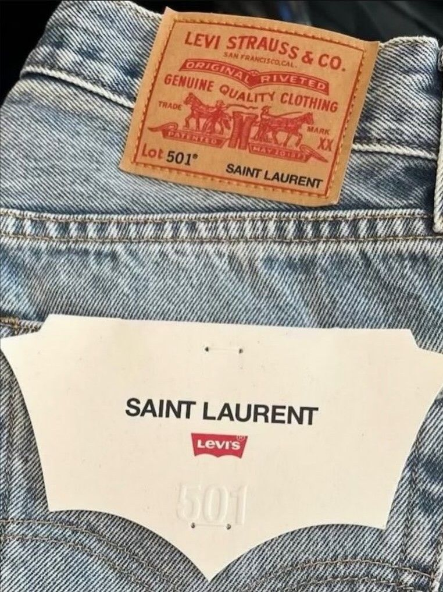

# Fashion news digest – 23 November 2026

## Top of the night

1. Leaked Saint Laurent x Levi's 501 images draw about 380K views on X, one of the weekend's biggest brand posts; neither brand has confirmed.
2. Agentic commerce gets real for holiday: ChatGPT wallet launches, Amazon blocks Meta's Muse shopping agent, Walmart adds agent spend caps.
3. Quiet news weekend otherwise: Las Vegas GP celebrity style, an averted LA/Long Beach port strike and Nike's GYAKUSOU revival lead the rest.

## Fashion tech & AI

### 2. Holiday 2026 becomes the 'agentic commerce quarter': ChatGPT wallet launches, Amazon blocks Meta's Muse agent

Digiday (via Modern Retail) rounds up a week in which OpenAI launched a ChatGPT wallet to push agent purchases through retailer checkouts, Google began rolling out agent checkout in Canada through AI Mode and Gemini, Amazon blocked Meta's Muse shopping agent from its site and Walmart let shoppers cap an agent's spend at $50, $100 or $200. Bain estimates roughly one in four online shoppers plan to start holiday shopping on an AI platform. Gartner data cited in the piece shows 61% of senior marketers have reworked content for machine readability, but only about 30% have built workflows for agent-led transactions.

**Why it matters for On-Model/PiktID:** When an agent picks the product, structured data and clean on-body imagery for every SKU decide whether a brand is shown at all.

Sources: [modernretail.co](https://www.modernretail.co/technology/in-graphic-detail-welcome-to-the-agentic-commerce-quarter/)

Influence score: 8/10 · Engagement seen: none visible · Published: 2026-11-19 · **update**

_Note: Update to 21 Nov item on Meta's Muse: Amazon has blocked the agent from its retail site._

### 8. Bodi.Me fit research: 'plus size' and 'curvy' need different patterns, and size labels vary by up to 46 cm

UK sizing-tech firm Bodi.Me presented two years of body-data research on curvy and plus-size wearers in the US, UK and EU at 3DBodyTech 2026 in Lugano. FashionUnited reports its core finding that plus size (a size range) and curvy (a waist-to-hip proportion) are different fit problems that brands often merge, so uniform grading fixes one area and creates excess fabric in another. A cross-brand check found a 2XL chest starting at 100.5 cm at Tom Tailor versus 146 cm at Universal Standard, and the firm argues size-mix data hides fit problems that then repeat in the next production run.

**Why it matters for On-Model/PiktID:** Extended sizes are where model imagery is thinnest; showing each garment on the right body shape is a fit-communication tool, not just a visual.

Sources: [fashionunited.com](https://fashionunited.com/news/fashion/how-better-sizing-eases-the-strain-on-the-fashion-supply-chain/2026112075876)

Influence score: 5/10 · Engagement seen: none visible · Published: 2026-11-20

### 9. Moda Operandi co-founder relaunches Tinker Tailor as an AI made-to-order platform for creators

BoF reports that Áslaug Magnúsdóttir has relaunched Tinker Tailor as an AI creator platform backed by a $3 million pre-seed round. The made-to-order model gives influencers the design tools and supply chain to launch custom apparel lines, with the aim of cutting inventory waste. Details beyond BoF's summary are behind its paywall.

**Why it matters for On-Model/PiktID:** Creator-led, made-to-order lines have no physical samples to shoot, so they need imagery generated from designs or first units.

Sources: [businessoffashion.com](https://www.businessoffashion.com/articles/technology/tinker-tailor-relaunch/)

Influence score: 5/10 · Engagement seen: none visible · Published: 2026-11-19

_Note: Verified from BoF headline and standfirst only (paywalled)._

## E-commerce & retail business

### 4. LA and Long Beach port strike averted days before peak holiday shipping

The Pacific Maritime Association and ILWU Local 26 reached a tentative contract on Saturday for about 250 port watchmen, removing the threat of a picket line that thousands of dockworkers were expected to honour. Sourcing Journal says a stoppage would have hit six of the two ports' 13 container terminals and more than half of their cargo, at a time when rail-bound containers were already waiting about nine days for a rail car. More than 110 trade groups had urged a deal; terms were not disclosed and ratification is pending.

[Full resolution (Drive)](https://drive.google.com/file/d/1swuN-bN_pFWSF6N-D-UAnyoiO498yLMA/view) · [Source image](https://wwd.com/wp-content/uploads/2026/11/oneportlb.jpg) · image credit: source outlet/post, internal reference only

Sources: [wwd.com](https://wwd.com/sourcing-journal/logistics/los-angeles-la-long-beach-ports-avert-strike-250-watchmen-tentative-deal-ilwu-pma-1239461394/)

Influence score: 6/10 · Engagement seen: none visible · Published: 2026-11-21

## Brands, launches & deals

### 1. Leaked Saint Laurent x Levi's 501 images spread fast on X, but neither brand has confirmed

Images of what appears to be a co-branded Levi's 501 with Saint Laurent detailing are circulating online: Hypebeast describes light-wash, mid-wash and black versions with a co-branded leather back patch, 'Saint Laurent Paris' rivets and a gold-embroidered YSL monogram on the pocket. Neither Saint Laurent nor Levi's has confirmed the project. Online speculation puts the price far above a standard 501, though no official figure exists. A 'first look' post by @Ovrnundr was among the most-viewed fashion posts on X over the weekend.

**Why it matters for On-Model/PiktID:** Luxury-on-heritage-basic collabs live or die on detail shots (patches, rivets, embroidery): the kind of close-up fidelity on-model generation has to preserve.

[Full resolution (Drive)](https://drive.google.com/file/d/1lG4nkqWvFJqPTsYZ-M59WMombED5ahIf/view) · [Source image](https://pbs.twimg.com/media/HXprntYWAAAO0Yg?format=jpg&name=orig) · image credit: source outlet/post, internal reference only

Sources: [hypebeast.com](https://hypebeast.com/2026/11/saint-laurent-ysl-levis-501-jeans-collaboration-surfaces-online-teaser) · [x.com](https://x.com/Ovrnundr/status/2124128511900389495)

Influence score: 8/10 · Engagement seen: x ovrnundr views: 379,640, x ovrnundr likes: 4,670, x ovrnundr reposts: 743, x ovrnundr replies: 91 · Published: 2026-11-21 · **unverified: leak not confirmed by the brands**

_Note: Unconfirmed leak: images verified as circulating (Hypebeast), collaboration not confirmed by either brand._

### 5. Nike and Jun Takahashi revive GYAKUSOU after a five-year pause

Undercover founder Jun Takahashi announced on social media that GYAKUSOU, his Nike running sub-label launched in 2010 and paused in 2021, is coming back, with its first film in seven years featuring the three original members of his GIRA running crew. Hypebeast reports a new collection is expected for Holiday 2026, and runners have been seen in a collaborative Alphafly 4.

Sources: [hypebeast.com](https://hypebeast.com/2026/11/nike-jun-takahashi-gyakusou-official-return-announcement) · [sneakernews.com](https://sneakernews.com/2026/11/19/jun-takahashi-announces-the-return-of-nike-gyakusou/)

Influence score: 6/10 · Engagement seen: none visible · Published: 2026-11-19

_Note: Campaign image shows real people (from behind); not stored._

### 6. Dior signs Stray Kids' Hyunjin as ambassador for beauty and Jonathan Anderson's collections

Dior has named Stray Kids member Hyunjin a brand ambassador covering Dior Beauty and the collections designed by creative director Jonathan Anderson. Hypebeast notes he sat front row at Dior's January men's show and two women's shows, and that a September Instagram post of him in a Dior x A24 tee drew 2.6 million likes. The deal lands during Stray Kids' world tour, which runs to July 2027.

Sources: [hypebeast.com](https://hypebeast.com/2026/11/dior-names-stray-kids-hyunjin-new-brand-ambassador-announcement) · [x.com](https://x.com/LooxMagazine/status/2124091098423525854)

Influence score: 6/10 · Engagement seen: x looxmagazine views: 3,089, x looxmagazine likes: 413, x looxmagazine reposts: 91 · Published: 2026-11-21

### 10. Gucci will show Cruise 2028 in Shanghai, Demna's first show in the city

Gucci will stage its Cruise 2028 runway in Shanghai on 17 May 2027, Demna's first show there, timed to the 30th anniversary of the house's first store in the region (Hypebeast). It follows his Cruise debut in New York's Times Square and joins planned China shows by Dior and Zegna. In the same week sacai announced its first Hong Kong runway, for SS27, on 13 December.

Sources: [hypebeast.com](https://hypebeast.com/2026/11/gentle-monster-joaquin-phoenix-gucci-beams-adidas-sacai-willy-chavarria)

Influence score: 5/10 · Engagement seen: none visible · Published: 2026-11-20

## Celebrity & red carpet

### 3. Las Vegas Grand Prix doubles as a runway: archival Dior on Kim Kardashian, Balenciaga boots on Teyana Taylor

Styled by Law Roach, Kim Kardashian went Ferrari red and black: a black leather trench over the red lace-up latex trousers from John Galliano's Dior Fall 2003 collection, with red gladiator heels from Roberto Cavalli Spring 2005 (Red Carpet Fashion Awards); other outlets also reported a custom Chrome Hearts leather look. WWD says Teyana Taylor paired a handcrafted Alpinestars racing jacket, one of eight, in black with cobalt stripes, with a Y2K flame tee and Balenciaga's 34-inch over-the-knee Motocross heel boots. Complex Style posted LISA wearing Ferrari at the race.

Sources: [redcarpet-fashionawards.com](https://www.redcarpet-fashionawards.com/2026/11/22/kim-kardashians-ferrari-red-for-the-las-vegas-grand-prix/) · [wwd.com](https://wwd.com/footwear-news/shoe-trends/teyana-taylor-racer-jacket-balenciaga-boots-grand-prix-1239461809/) · [fashiontimes.com](https://www.fashiontimes.com/kim-kardashian-wears-custom-chrome-hearts-leather-look-las-vegas-grand-prix-15414) · [x.com](https://x.com/ComplexStyle/status/2124499628343087557) · [x.com](https://x.com/leandek15/status/2124343569234452965)

Influence score: 7/10 · Engagement seen: x leandek15 kim views: 69,106, x leandek15 kim likes: 3,226, x complexstyle lisa views: 17,465, x complexstyle lisa likes: 2,811, x complexstyle lisa reposts: 945 · Published: 2026-11-22

_Note: Chrome Hearts look reported by Fashion Times and X posts; not opened. LISA outfit details beyond 'Ferrari' not verified._

## Social trends (X/TikTok)

### 7. Miss Universe 2026 prelims: the Philippines' gold-and-teal 'Golden Seas of Sulu' gown leads pageant fashion talk

At the preliminary competition in Puerto Rico, Bea Millan-Windorski wore a gold and deep-blue gown by Filipino designer Anthony Ramirez, with radiating beadwork on a fitted bodice and floor-length skirt, a thigh-high slit and sheer teal panels from the arms that read as a cape, meant to evoke Mindanao goldwork and the Sulu Sea (GMA News). Her swimsuit segment look, a blue two-piece with a sheer white cape, was by Rian Fernandez. A fan clip of the gown passed 65,000 views on X within an hour; the final is on 25 November (Manila time).

Sources: [gmanetwork.com](https://www.gmanetwork.com/news/lifestyle/shoppingandfashion/1010453/bea-millan-windorski-showcases-golden-seas-of-sulu-at-miss-universe-2026-preliminaries/story/) · [manilatimes.net](https://www.manilatimes.net/2026/11/23/entertainment-lifestyle/show-times/bea-millan-windorski-showcases-golden-seas-of-sulu-gown-at-miss-universe-2026-preliminaries/2475809) · [x.com](https://x.com/Dainsleif_10/status/2124678879604506671)

Influence score: 6/10 · Engagement seen: x dainsleif 10 views: 65,400, x dainsleif 10 likes: 2,105, x dainsleif 10 reposts: 394 · Published: 2026-11-23

## TikTok search insights

- Creator Search Insights' keyword and content-gap view still isn't offered on TikTok web for this account, so no search-keyword or content-gap figures tonight. TikTok Studio > Inspiration > Trending (Beauty & Style, all regions) used instead; figures are the pairs shown (likely views / likes).

- #skincare #facemask (blackheads): 11M / 723K (as shown)
- #memoryquilt #costuracreativa: 3.2M / 278K (as shown)
- #fashion #DIY (shrinking an XXL sweater): 1.6M / 117K (as shown)
- #hairstyle: 1.9M / 22K (as shown)
- #fashion #design #sewing: 833K / 72K (as shown)
- fabric unboxing to recreate a wedding dress: 750K / 75K (as shown)

- Gap On-Model could fill: fashion in the trending set is again DIY/transformation (resizing a sweater, sewing, recreating a dress from fabric). A 'flat garment to on-body' transformation in the same before/after format is still absent.

## Sources checked

- X: signed in. Explore trending (Italy; football/F1, no fashion topics), searches for fashion (Top, 500+ likes), AI fashion / virtual try-on / AI models / fashion tech (Top; only low-reach posts), red carpet / outfit / fashion week / Vogue (Top, 2,000+ likes), Hyunjin Dior.
- TikTok: signed in. Searches 'fashion news' (mostly older posts) and 'creator search insights'.
- TikTok Creator Search Insights: unavailable on web (keyword/gap view); TikTok Studio Inspiration trending used.
- News: The Interline (no new posts since 20 Nov), Business of Fashion (paywalled; standfirsts only), Vogue Business (nothing new in window), WWD, Sourcing Journal, FashionUnited (some member pieces paywalled), Hypebeast, Modern Retail, TechCrunch (no fashion items), Red Carpet Fashion Awards, GMA News. Not reached this run: Drapers, Just Style, Retail Dive, The Verge, Highsnobiety.
- Weekend window was thin, so items 2, 5, 8, 9 and 10 are 19-21 November stories not in earlier digests.
- Not used: MAMA red carpet (covered 21 Nov), Paolo Bulgari (covered 22 Nov), Gentle Monster x Joaquin Phoenix smart-glasses film (launched 6-12 Nov; US/Korea launch 10 Dec), Vestiaire Collective ChatGPT app (~16 Nov), Zara Fifth Avenue reopening and Wandler v Loewe (paywalled), Zalando AI piece (BoF, Sept).
- Images: the workspace network blocks direct downloads, so images are browser renders at the source's native size; 2 uploaded to the [Drive day folder](https://drive.google.com/drive/folders/1DKjvC--RLCnogRD039_f4j0Ubu6cSjkl) and previewed here. No photos of real people stored (celebrity, pageant and GYAKUSOU campaign images skipped).

## Possible LinkedIn angles

- A leaked jeans patch got 380K views: in luxury collabs the detail shot is the product. Why garment fidelity is the bar for AI imagery.
- Amazon just blocked Meta's shopping agent. In agentic commerce, your product data and images are your storefront; who gets to read them is the new channel war.
- 'Plus size' isn't 'curvy' (Bodi.Me): extended sizes need images on the right body shape, not one model scaled up.
