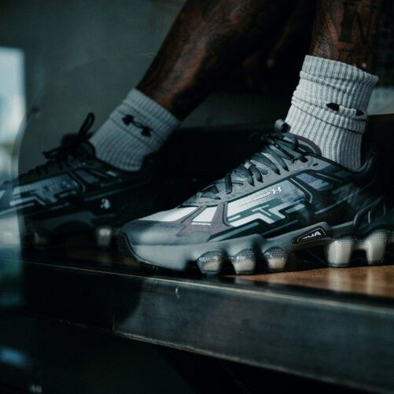
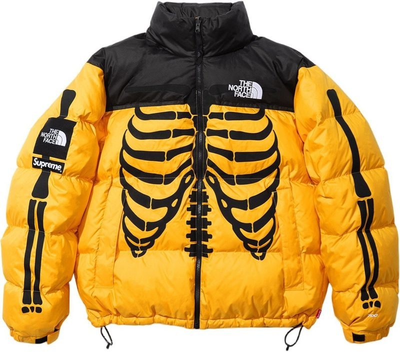
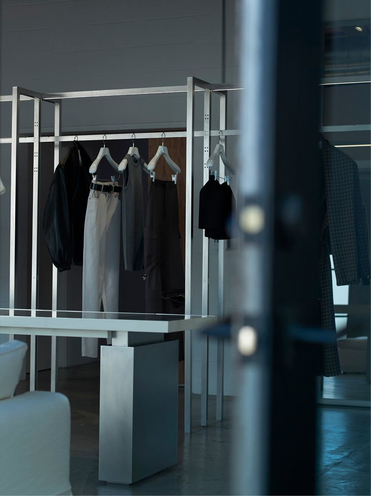

# Fashion news digest – 24 November 2026

## Top of the night

1. AI pricing goes mainstream: Reuters finds Gap, Under Armour and luxury houses using AI to cut Black Friday discount depth.
2. Bangladesh wage talks stall; unrest has cost an estimated $428M and moved orders for 59M garments to other countries.
3. On X: Miu Miu's Becky Armstrong signing (483K views), Supreme x The North Face 'Bones' (327K) and Vogue's Best Dressed cover with Connor Storrie (439K).

## Fashion tech & AI

### 1. AI pricing tools are quietly shrinking Black Friday discounts at Gap, Under Armour and others

Reuters, in a piece carried by BoF and FashionNetwork, reports that brands from Gap to Under Armour now use AI tools to set prices and decide when and how deeply to discount, and that the software often concludes promotions can be smaller without hurting demand. Examples from vendors include a beauty brand cutting a planned 40% Black Friday discount to 30% (Kapnova) and a buy-one-get-one offer trimmed from 50% to 40% (First Insight); Anaplan names Tiffany, Dolce & Gabbana and Saint Laurent as pricing clients. Centric Market Intelligence data show more sportswear on sale but shallower average markdowns, e.g. sports bras at 32% off versus 36% a year earlier.

**Why it matters for On-Model/PiktID:** AI is moving from content to margin decisions in fashion; the same buyers approving AI pricing are the ones who will approve AI product imagery, and both pitches rest on measurable margin impact.

[Full resolution](https://drive.google.com/file/d/1ly3VGJojijBa-X3DqsqEmOhvf1OKj6cl/view) · image source: [media.fashionnetwork.com](https://media.fashionnetwork.com/m/437d/5bcf/bc50/a978/09fa/7d71/4794/e144/89a9/b4ca/b4ca.jpg) (internal reference only)

Sources: [fashionnetwork.com](https://ww.fashionnetwork.com/news/Ai-tools-help-brands-curb-black-friday-deals-from-clothes-to-skincare,1887408.html) · [businessoffashion.com](https://www.businessoffashion.com/news/retail/ai-tools-help-brands-curb-black-friday-deals-from-clothes-to-skincare/)

Influence score: 8/10 · Engagement seen: none visible · Published: 2026-11-23

### 8. Debenhams Group launches a Meta-powered AI Gift Finder inside WhatsApp

Debenhams Group, which also runs boohoo, Karen Millen, PrettyLittleThing and Man, has launched a Gift Finder on WhatsApp built with Meta's AI (FashionNetwork). Shoppers arrive from Facebook and Instagram ads or a QR code, tell a business agent who they are buying for, their budget and preferences, and get recommendations plus a link to a pre-filled Debenhams basket. CEO Dan Finley frames it as in-store-style assistance on a platform customers already use.

**Why it matters for On-Model/PiktID:** Conversational shopping shows a handful of products at thumbnail size in a chat; each SKU's lead image has to sell on its own.

Sources: [fashionnetwork.com](https://ww.fashionnetwork.com/news/Debenhams-launches-ai-powered-gift-finder-on-whatsapp,1887542.html)

Influence score: 6/10 · Engagement seen: none visible · Published: 2026-11-23

_Note: Campaign image shows models; not stored._

### 9. Sizing-AI company MySize posts a 28% revenue drop and flags going-concern doubts

Israel's MySize, which sells AI sizing software alongside fashion e-commerce and resale, reported third-quarter revenue down about 28% to $1.86M and a net loss of $1.80M, mainly on lower Amazon sales from thin inventory (Oui Speak Fashion). Its SaaS revenue grew 25% to $240,000 at roughly 82% gross margin and resale rose about 19%, but the company says current cash may not fund the next 12 months, raising substantial doubt about its ability to continue as a going concern.

**Why it matters for On-Model/PiktID:** A reminder that fit-tech buyers will scrutinise vendor stability; standalone AI tools with small SaaS lines struggle when bundled with low-margin retail.

Sources: [ouispeakfashion.com](https://ouispeakfashion.com/mysize-q3-2026-results-going-concern)

Influence score: 5/10 · Engagement seen: none visible · Published: 2026-11-23

_Note: Results released 20 Nov; article published 23 Nov. Article image shows models; not stored._

### 13. The Interline: Straight Lines AI argues fashion needs AI image platforms, not one-off tools

In The Interline's 'All About AI' series, Dale Kort of Straight Lines AI says fashion should no longer accept generative tools that 'just hallucinate sometimes' or that make teams sift many outputs to find one usable image. He pitches a platform layered over several foundation models with fashion-specific controls for colour accuracy, material rendering, construction details and consistency across a line, plus plugins, open APIs and integration with existing 3D pipelines.

**Why it matters for On-Model/PiktID:** Same buyer objection On-Model faces daily: consistency and garment fidelity, not novelty, decide enterprise AI imagery deals.

[Full resolution](https://drive.google.com/file/d/19X1K-YOrAY7WS6TGBYkCSV-yU750LQeV/view) · image source: [theinterline.com](https://www.theinterline.com/wp-content/uploads/2026/11/Dale-Straight-Lines-Header.jpg) (internal reference only)

Sources: [theinterline.com](https://www.theinterline.com/2026/11/23/all-about-ai-dale-kort-of-straight-lines-ai/)

Influence score: 4/10 · Engagement seen: none visible · Published: 2026-11-23

## E-commerce & retail business

### 2. Bangladesh garment wage talks stall as unrest costs an estimated $428M and moves orders abroad

Sourcing Journal (WWD) reports that Bangladesh's minimum wage board failed to agree a new garment-worker wage on Monday after nine and a half hours of talks; an extended session follows on Tuesday. Workers' representatives want 32,000 taka ($257) a month, up from 12,500 taka, while owners call that untenable; the employers' undisclosed offer is said to exceed 14,500 taka. The BGMEA says buyers have moved confirmed orders for 59 million garments ($254M) to other countries, and a survey of 317 factories that halted work for 1-16 days this month puts losses at $428M FOB. Groups whose members include H&M, Gap, Primark, Levi's, Fast Retailing and Inditex have criticised the detention of union leaders.

**Why it matters for On-Model/PiktID:** Sourcing shocks push brands to shorten sampling and shoot cycles; imagery that doesn't wait for physical samples helps absorb late or rerouted production.

Sources: [wwd.com](https://wwd.com/sourcing-journal/sustainability/bangladesh-minimum-wage-garment-workers-loss-1239463170/)

Influence score: 7/10 · Engagement seen: none visible · Published: 2026-11-23

_Note: Article image shows protesters (identifiable people); not stored._

### 7. NRF expects fewer Thanksgiving-weekend shoppers, but 59% plan to use AI to shop this season

The National Retail Federation now expects 182.7 million people to shop over Thanksgiving weekend, down more than 2% on last year, as long pre-Black Friday sales pull spending forward (Retail Dive). Its survey of nearly 8,000 consumers found 59% plan to use AI to shop, mainly for product recommendations (32%) and gift ideas (31%), while 82% are reining in holiday budgets. Circana sees fourth-quarter holiday sales anywhere from -1% to +2.5% year over year.

**Why it matters for On-Model/PiktID:** With most shoppers asking AI what to buy, product pages need imagery and data that assistants can parse and trust, not just human-facing banners.

Sources: [retaildive.com](https://www.retaildive.com/news/black-friday-cyber-monday-shopping-projected-to-slip/875473/)

Influence score: 6/10 · Engagement seen: none visible · Published: 2026-11-23

_Note: Article image is a stock photo of shoppers; not stored._

### 12. Next says an online supplier was hacked but customer data appears safe

UK retailer Next said on Monday that a third-party online supplier suffered a cyber incident giving attackers access to some data relating to the company, adding that current evidence shows no customer personal data was compromised and the information cannot be used for fraud (Reuters via FashionNetwork). It is the latest in a run of UK retail cyber incidents, after last year's attack that halted Marks & Spencer's online sales for about six weeks.

Sources: [fashionnetwork.com](https://ww.fashionnetwork.com/news/Uk-s-next-flags-cyber-breach-at-online-supplier-says-no-customer-data-compromised,1887412.html) · [businessoffashion.com](https://www.businessoffashion.com/news/retail/next-supplier-hit-by-cyberattack/)

Influence score: 5/10 · Engagement seen: none visible · Published: 2026-11-23

## Brands, launches & deals

### 3. Supreme and The North Face drop a skeleton-print 'Bones' collection on 27 November

Supreme's first collection with The North Face in two years puts its Bones graphic on a 700-fill Nuptse puffer, a DryVent Mountain Jacket and matching pant, a pile fleece and a tee, plus a 34.5-litre rolltop backpack, balaclava and touchscreen gloves (Sneaker Bar Detroit). It releases on 27 November in Supreme stores and online. A preview post by @Ovrnundr passed 327,000 views on X within hours, and the campaign stars the Drain Gang collective.

**Why it matters for On-Model/PiktID:** Hype drops sell out on product imagery alone; the Bones graphic wrapping a puffer is exactly the kind of print-placement detail on-model renders must keep exact.

[Full resolution](https://drive.google.com/file/d/1oXniDO2nLRv_NWhhtGx3PxUq20epzsMG/view) · image source: [cdn.supremecommunity.com](https://cdn.supremecommunity.com/supremecommunity/prod/season/fall-winter2026/fall-winter2026-supreme-the-north-face-bones-nuptse-jacket-b6feaeaf.jpg) (internal reference only)

Sources: [sneakerbardetroit.com](https://sneakerbardetroit.com/supreme-the-north-face-bones-collection/) · [modernnotoriety.com](https://modernnotoriety.com/supreme-the-north-face-bones-release-date/) · [x.com](https://x.com/Ovrnundr/status/2124834716608025042)

Influence score: 7/10 · Engagement seen: x ovrnundr views: 327,086, x ovrnundr likes: 2,344, x ovrnundr reposts: 281, x ovrnundr replies: 65 · Published: 2026-11-23

_Note: Image is the product shot of the Nuptse (via SupremeCommunity); the campaign image shows people and is not stored._

### 4. Miu Miu names Thai-British actress Becky Armstrong brand ambassador

Miu Miu announced on its official X account that Becky Armstrong, the Thai-British actress, is its new brand ambassador. The announcement video drew about 483,000 views and nearly 11,000 likes in 17 hours, and Vogue Thailand's post on the news collected over 2,600 reposts. It extends the Prada Group label's push with Thai talent, whose fan bases routinely drive the highest engagement on luxury posts in the region.

Sources: [x.com](https://x.com/MIUMIUofficial/status/2124791286935007504) · [x.com](https://x.com/VogueThailand/status/2124791760295801131)

Influence score: 7/10 · Engagement seen: x miumiuofficial views: 482,543, x miumiuofficial likes: 10,906, x miumiuofficial reposts: 6,566, x voguethailand reposts: 2,612 · Published: 2026-11-23

_Note: Verified from the brand's official X account; no news article opened. No photo stored (real person)._

### 10. Phoebe Philo opens a shop-in-shop at Dover Street Market Los Angeles

Phoebe Philo opened a dedicated space at Dover Street Market's downtown LA store on Monday, carrying ready-to-wear, leather goods, shoes and accessories from Collection E plus earlier pieces; Collection F arrives in early 2027 (WWD). The fit-out uses brushed steel rails, cherry-wood vitrines and Douglas fir shelving. It joins her DSM shops in London, New York, Ginza and Singapore; Philo remains majority owner, with LVMH holding a minority stake.

[Full resolution](https://drive.google.com/file/d/1gALcCQJUQaMShJPhgR1qLB8dfPXfUnJ3/view) · image source: [wwd.com](https://wwd.com/wp-content/uploads/2026/11/PP_DSM_LA_3X4.jpg) (internal reference only)

Sources: [wwd.com](https://wwd.com/fashion-news/fashion-scoops/phoebe-philo-dover-street-market-los-angeles-shop-1239463038/)

Influence score: 5/10 · Engagement seen: none visible · Published: 2026-11-23

## Celebrity & red carpet

### 5. Vogue picks 'Heated Rivalry' star Connor Storrie for its 2026 Best Dressed cover

Vogue named actor Connor Storrie, a Saint Laurent ambassador, its 2026 Best Dressed digital cover star, recapping a year that ran from a sharp-shouldered suit at the Golden Globes to a polka-dot halter top at the Met and PVC boots front row at Saint Laurent. In the Collier Schorr shoot, styled by Spencer Singer, he wears Loewe, Prada, Gucci, Versace, Loro Piana, Miu Miu, Calvin Klein Collection and The Row, often with Falke socks and Church's shoes. Pop Base's cover post passed 439,000 views on X, and several fan and film accounts drove another million-plus.

Sources: [vogue.com](https://www.vogue.com/article/connor-storrie-best-dressed-2026-digital-cover) · [x.com](https://x.com/PopBase/status/2124854498384302445) · [x.com](https://x.com/FilmUpdates/status/2124853760375529564)

Influence score: 7/10 · Engagement seen: x popbase views: 439,082, x popbase likes: 23,024, x popbase reposts: 2,019, x filmupdates views: 318,447, x filmupdates likes: 19,905 · Published: 2026-11-23

_Note: No photo stored (real person)._

### 11. Rihanna's Lady Dior 2027 campaign is still one of the most-shared luxury images on X

Rihanna fronts Dior's 2027 Lady Dior campaign, shot by Sam Rock under Jonathan Anderson's creative direction, in portraits alone and with her youngest child (Hypebae, 19 November). The imagery kept circulating over the weekend: a post pairing her with singer Tyla 'for Dior' passed 890,000 views on X, and campaign posts by fan accounts added hundreds of thousands more. She has also been the face of Dior's J'adore fragrance since 2024.

Sources: [hypebae.com](https://hypebae.com/2026/11/rihanna-lady-dior-bags-campaign-daughter-rocki-jonathan-anderson-sam-rock-information) · [x.com](https://x.com/Amacvkaiu/status/2124693679382118632) · [x.com](https://x.com/gabgonebad/status/2124666427697512634)

Influence score: 5/10 · Engagement seen: x amacvkaiu views: 891,777, x amacvkaiu likes: 15,007, x gabgonebad views: 86,911, x robynement views: 78,605 · Published: 2026-11-19 · **unverified social claim (see note)**

_Note: Campaign verified (Hypebae); the X post's pairing of Tyla with Dior is an unverified social claim (no news source found). No photos stored (real people, includes a minor)._

## Social trends (X/TikTok)

### 6. Chiara Ferragni's Netflix documentary 'Chiara' lands and puts her back at the top of Italian X

'Chiara', the documentary in which the Italian influencer-entrepreneur tells her side of the past three years, began streaming on Netflix on 23 November (DonnaGlamour, citing SkyTG24). In a Vanity Fair interview tied to the launch she called the pandoro charity-sales operation a mistake for which she, as CEO, was responsible (Il Giorno). 'Ferragni' was among Italy's top X trends overnight, with one post about the film passing 283,000 views; reactions are split between sympathy and accusations of self-justification.

Sources: [donnaglamour.it](https://www.donnaglamour.it/chiara-ferragni-quando-esce-documentario-netflix-data/people/amp/) · [ilgiorno.it](https://www.ilgiorno.it/cronaca/chiara-ferragni-pandoro-operazione-sbagliata-con-fedez-mi-sentivo-sola-non-vivo-piu-per-lapplauso-della-gente-hfb86bwi) · [x.com](https://x.com/__Fabiana___/status/2124887532164796467)

Influence score: 6/10 · Engagement seen: x trending italy: Ferragni in Italy trending list, x fabiana views: 283,019, x fabiana likes: 3,704 · Published: 2026-11-23

_Note: No photo stored (real person)._

## TikTok search insights

- Creator Search Insights' keyword and content-gap view still isn't offered on TikTok web for this account, so no search-keyword or content-gap figures tonight. TikTok Studio > Inspiration > Trending (Beauty & Style, all regions) used instead; figures are the pairs shown (likely views / likes).

- #skincare #facemask (blackheads): 11M / 743K (as shown)
- #memoryquilt #costuracreativa: 3.2M / 284K (as shown)
- #hairstyle: 1.9M / 23K (as shown)
- #fashion #DIY (shrinking an XXL sweater; TikTok Awards UK nominee): 1.7M / 121K (as shown)
- #barber transformation haircut: 1.1M / 154K (as shown)
- #fashion #design #sewing #blackfashiondesigner: 1M / 90K (as shown)
- #christmasnails #3dnails: 884K / 64K (as shown)

- Gap On-Model could fill: the fashion entries are again DIY and sewing transformations (shrinking a sweater, design-to-garment). A before/after 'flat garment to on-body' format is still absent from the trending set.

## Sources checked

- X: signed in. Searches for fashion (Top, 500+ likes), outfit/red carpet/Dior/Chanel/Prada/Vogue (Top, 3,000+ likes), AI fashion / virtual try-on / AI models / fashion tech / AI campaign (Top, 100+ likes; mostly AI-art accounts, no news), Ferragni; Explore trending (Italy: Ferragni was the only fashion-adjacent trend).
- TikTok: signed in. Search 'fashion news' (mostly older recap videos); TikTok Studio Inspiration trending.
- TikTok Creator Search Insights: unavailable on web (keyword/gap view).
- News: The Interline (2 posts on 23 Nov), Business of Fashion (paywalled; headlines), FashionNetwork (Reuters wires), WWD / Sourcing Journal, Retail Dive, Modern Retail, Vogue, Hypebae, Sneaker Bar Detroit, Oui Speak Fashion, Il Giorno, DonnaGlamour. Not reached this run: Vogue Business, FashionUnited, Drapers, Just Style, TechCrunch, The Verge, Highsnobiety (no WebFetch this run; pages opened in the browser).
- Not used: Tod's €400M refinancing and General Pants administration (BoF headlines only), Christian Dior/Agache merger terms (older), GTA VI retail promos (not fashion), Miss Lebanon 'AI wings' costume claim on X (no source found), Nike Mind 001 leopard colourway, Ugg Covent Garden store.
- Images: workspace network blocks direct downloads, so images are browser renders at the source's native size; 4 uploaded to the [Drive day folder](https://drive.google.com/drive/folders/15M0x3hFkFzUu_Qvrlcp2wzN_0stqTsMV) and previewed here. No photos of real people stored (Miu Miu, Vogue, Rihanna, Ferragni, Supreme campaign, Debenhams, MySize and Bangladesh images skipped).

## Possible LinkedIn angles

- AI is now deciding how deep Black Friday discounts go. Next: deciding which product images convert. Margin, not novelty, is the AI business case in fashion.
- 59% of US shoppers will use AI to shop this season (NRF). If an assistant picks your product, your lead image is the whole storefront.
- 'AI that just hallucinates sometimes' is no longer acceptable (The Interline). Garment fidelity is the bar for AI fashion imagery.
