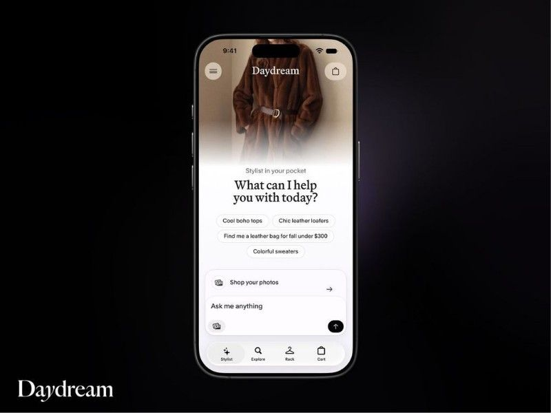
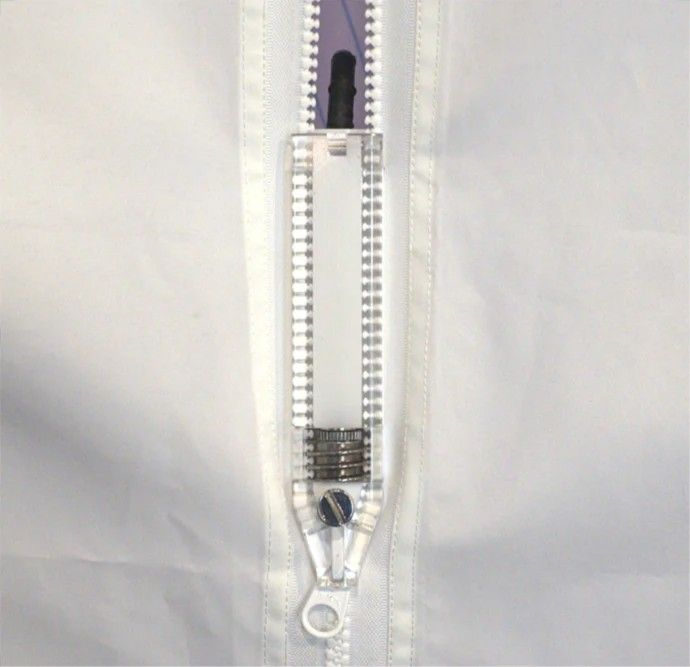

# Fashion news digest – 21 November 2026

_First edition: as there is no previous digest, the window covers 17-21 November, weighted to the last 24-48 hours._

## Top of the night

1. Nike replaces Puma as Formula 1's official apparel partner from 2027; Las Vegas capsule already on sale.
2. Virtual try-on goes agentic: Meta's Muse and Daydream let AI shoppers preview clothes on you before buying.
3. Italian couture mourns Raffaella Curiel (83); Gap names a new Athleta CEO as shares rise 11%.

## Fashion tech & AI

### 2. AI shopping agents add virtual try-on: Meta's Muse and Daydream move into fashion

Meta's personal agent Muse now offers a Try On feature that previews the exact clothing listing it found on the shopper before ordering, positioned as a look preview rather than a fit guarantee (iPhone in Canada, 19 November). Two days earlier, Julie Bornstein's startup Daydream launched Daydream Agent, which remembers style, fit and budget, reuses an uploaded photo to try on saved items and checks out in one click across a catalogue of 10,000+ brands (TechCrunch). TechCrunch also reports Zuckerberg saying shopping is a top Muse activity among its 10M+ users. On X, some founders question whether consumer try-on drives lasting engagement.

**Why it matters for On-Model/PiktID:** Try-on is becoming a default layer of agentic shopping; brands will need consistent, high-quality on-model product imagery that these agents can render from.

Full resolution: [source image](https://techcrunch.com/wp-content/uploads/2026/11/2daydream-agent-1.jpeg) (no Drive copy this run; image credit: original publisher, internal reference only)

Sources: [iphoneincanada.ca](https://www.iphoneincanada.ca/2026/11/19/meta-muse-try-on-clothes/) · [techcrunch.com](https://techcrunch.com/2026/11/17/daydreams-new-ai-agent-acts-as-your-personal-stylist-and-can-shop-for-you-too/) · [x.com](https://x.com/PhilipQiu5/status/2123605444002263131)

Influence score: 8/10 · Engagement seen: x post philipqiu views: 3,988, x post philipqiu likes: 37, x post philipqiu replies: 28 · Published: 2026-11-19

### 6. Nest founder Tony Fadell becomes Smartex.ai chairman and co-designs AI fabric inspection hardware

Smartex.ai appointed Tony Fadell, of iPod, iPhone and Nest fame, as chairman; he also co-designed Inspect, a camera-and-sensor retrofit for mills' existing inspection machines that logs fabric defects and shade by roll position. Paired with Smartex's IQ software, it gives mills, factories and brands a shared view of fabric quality before material ships. The Interline (19 November) says the industry debut is planned at SmartCollab Hong Kong on 27 November.

**Why it matters for On-Model/PiktID:** Shows AI investment in fashion moving upstream; quality data tied to rolls and orders could eventually feed product data used for imagery.

Sources: [theinterline.com](https://www.theinterline.com/2026/11/19/tony-fadell-smartex-ai-fashion-hardware/)

Influence score: 6/10 · Engagement seen: not shown · Published: 2026-11-19

### 7. Barcelona's Fermat raises $8M seed for AI design and tech-pack platform

Fermat, whose platform turns sketches and moodboards into garment visuals and lets designers test fabrics and colours before sampling, raised an $8M seed led by Kibo Ventures and Lunar Ventures. It counts 350+ customers in 14 countries, including ASOS, J.Crew Group, New Look, s.Oliver and Tendam, and launched a Techpacks tool that generates technical flats, measurements and bills of materials. Revenue has tripled in 2026, the US is a third of it, and a New York office is next (Tech Funding News, 17 November).

**Why it matters for On-Model/PiktID:** Adjacent AI player upstream of On-Model in the design-to-PDP pipeline; same retailer accounts (ASOS, New Look) are potential partners or prospects.

Sources: [techfundingnews.com](https://techfundingnews.com/fermat-raises-8m-seed-as-ai-fashion-platform-triples-revenue-and-prepares-new-york-expansion/) · [theinterline.com](https://www.theinterline.com/2026/11/17/fermat-8m-seed-funding-ai-techpacks/)

Influence score: 6/10 · Engagement seen: not shown · Published: 2026-11-17

### 9. YKK returns to CES with a motorised zip and other connected trims

YKK will exhibit at CES in Las Vegas on 6-9 January 2027, its second year at the show, under the theme The Future of Connection. The headline exhibit is Zippilot, a motorised slider that opens and closes a zip, alongside an illuminated Glow Coil Zipper, a conductive top-stop that turns a zip into an electrical switch, and an on-demand trim fabrication system (The Interline, 19 November).

Full resolution: [source image](https://www.theinterline.com/wp-content/uploads/2026/11/20261117_im01.jpg) (no Drive copy this run; image credit: original publisher, internal reference only)

Sources: [theinterline.com](https://www.theinterline.com/2026/11/19/ykk-ces-2027-zippilot-fashion-trims/)

Influence score: 5/10 · Engagement seen: not shown · Published: 2026-11-19

### 10. The Interline: GTA 6 exposed how slow fashion calendars miss cultural moments

An Interline analysis (20 November) argues fashion largely missed the GTA 6 launch, one of the year's biggest cultural events, because 6-9 month lead times and fixed product calendars left brands unable to react, with brand-safety worries holding others back. It points to faster digital-print models and better trend sensing as the fix, citing activity around Selfridges, Nike, Cactus Jack, Oakley and New Era. BoF separately notes brands are now courting gaming's audience offline as the game's sales outpace Hollywood blockbusters.

**Why it matters for On-Model/PiktID:** Speed-to-market argument fits On-Model: imagery for reactive drops can be produced without a shoot.

Sources: [theinterline.com](https://www.theinterline.com/2026/11/20/gta-6-fashion-collections-product-calendar/)

Influence score: 5/10 · Engagement seen: not shown · Published: 2026-11-20

## E-commerce & retail business

### 4. Gap names a new Athleta CEO and trims its outlook, yet shares jump 11%

Gap Inc. reported flat comparable sales for its fiscal third quarter (net sales +2%, online +3%), blamed warm weather for a soft October and cut its full-year sales outlook to roughly flat, with adjusted EPS now guided at $2.29-$2.34 (CNBC, 19 November). It named former Vuori global president Ashley Kechter as Athleta CEO from 14 December after Athleta sales fell 14%. Signs of progress at Old Navy sent shares up more than 11% on Friday. Off-price rival Ross Stores went the other way: BoF reports the stock plunged as rising fuel costs weighed on its profit outlook despite sales beating estimates.

**Why it matters for On-Model/PiktID:** Weather-driven demand swings and margin pressure keep US apparel retailers focused on cutting content and production costs before the holidays.

Sources: [cnbc.com](https://www.cnbc.com/2026/11/19/gap-gap-q3-2026-earnings.html) · [businessoffashion.com](https://www.businessoffashion.com/news/retail/ross-stores-plunges-on-weaker-profit-outlook-as-fuel-costs-rise/)

Influence score: 6/10 · Engagement seen: not shown · Published: 2026-11-20

### 8. AI stock jitters hit luxury shares as Black Friday tests consumer spending

European luxury stocks fell about 2% on 17 November on fears that an AI-led market sell-off could curb wealthy shoppers' spending; Hermès dropped over 4% and Moncler 4.3% to a four-year low after a Morgan Stanley downgrade (Retail Gazette). Morgan Stanley went underweight on European luxury in its 2027 outlook, citing weak Chinese demand. Heading into Black Friday, BoF notes investors are now watching US consumer spending to steady a market shaken by the AI trade.

**Why it matters for On-Model/PiktID:** Tighter budgets at brands usually accelerate cost-cutting in photo production, a tailwind for AI imagery pitches.

Sources: [retailgazette.co.uk](https://www.retailgazette.co.uk/blog/2026/11/luxury-brands-hit-by-fears-ai-stock-sell-off-could-dent-wealthy-shoppers-spending/) · [businessoffashion.com](https://www.businessoffashion.com/news/retail/black-friday-brings-consumer-spending-into-focus-for-ai-rocked-market/)

Influence score: 5/10 · Engagement seen: not shown · Published: 2026-11-20

## Brands, launches & deals

### 1. Nike returns to Formula 1 as official apparel and uniform partner from 2027

Formula 1 named Nike its official apparel and uniform provider in a multi-year deal that fully starts with the 2027 season, taking over the role from Puma according to The Race. Nike will dress F1 staff worldwide, sell official fan merchandise and become the sporting apparel partner of F1 Academy. A limited Las Vegas Grand Prix capsule went on sale on 20 November at the F1 Hub at the Venetian and Nike's Las Vegas stores. Financial terms were not disclosed; the deal lands days after an investor day (17 November) where Nike targeted a return to market-level growth only in fiscal 2029 and shares fell about 6%.

**Why it matters for On-Model/PiktID:** Sport-fashion crossovers multiply product drops and capsules that need fast on-model imagery; a signal for sportswear e-commerce content volume in 2027.

Full resolution: [source image](https://imageio.forbes.com/specials-images/imageserve/6b00631bf78ef39d51c2d55e/0x0.jpg) (no Drive copy this run; image credit: original publisher, internal reference only)

Sources: [forbes.com](https://www.forbes.com/sites/maurybrown/2026/11/20/nike-announces-long-term-partnership-with-formula-1/) · [the-race.com](https://www.the-race.com/business/nike-to-return-to-f1-after-24-years/) · [businessoffashion.com](https://www.businessoffashion.com/news/sports/nike-to-become-formula-ones-official-apparel-and-uniform-partner/) · [fashionunited.com](https://fashionunited.com/news/business/nike-ceo-elliott-hill-reportedly-rallies-staff-after-investor-day-fails-to-lift-shares/2026111975852)

Influence score: 8/10 · Engagement seen: not shown · Published: 2026-11-20

### 5. Italian couturier Raffaella Curiel dies in Milan at 83

Raffaella Curiel, the Milanese couturier often called the intellectual of Italian fashion, died overnight in a Milan hospital where she was being treated for pneumonia, ANSA reported on 21 November; her children Gaetano and Gigliola announced the news. After training at Balmain in Paris she built her own maison on her mother's tailoring atelier, opened a New York showroom in 1992 and expanded to Japan. The brand was sold to China's Red Stone in 2016, with creative direction staying in the family. The story is trending in Italian fashion media and on TikTok.

Sources: [ansa.it](https://www.ansa.it/canale_lifestyle/notizie/moda/2026/11/21/morta-la-stilista-raffaella-curiel-lintellettuale-della-moda_f9c6a36c-fde8-42ad-8236-9c8009f2b064.html) · [adnkronos.com](https://www.adnkronos.com/moda/morta-raffaella-curiel_7KD9sbapMrEccTjaBABL3G) · [tiktok.com](https://www.tiktok.com/@_modami__/video/7710680332172823841)

Influence score: 6/10 · Engagement seen: not shown · Published: 2026-11-21

## Celebrity & red carpet

### 3. 2026 MAMA Awards red carpet in Osaka dominates fashion talk on X

The 2026 MAMA Awards red carpet at Osaka's Kyocera Dome (second day on 21 November) produced the weekend's biggest outfit conversation on X, with fan and official posts on TWICE's Nayeon, IVE, LE SSERAFIM, BABYMONSTER, TREASURE and Park Bo Gum reaching tens of thousands to over a million views. Korea Daily describes LE SSERAFIM in coordinated black-and-white ensembles; coverage so far (Soompi, Korea Daily) names no designers. No photos stored, per policy; follow the links for the looks.

Sources: [soompi.com](https://www.soompi.com/article/1889423wpp/stars-light-up-red-carpet-at-2026-mama-awards-chapter-2) · [en.koreadaily.com](https://en.koreadaily.com/le-sserafim-2026-mama-awards-red-carpet/) · [x.com](https://x.com/AboutMusicYT/status/2124000339468996678) · [x.com](https://x.com/sserapics/status/2123994841164271997) · [x.com](https://x.com/JYPETWICE/status/2124018045140300116)

Influence score: 7/10 · Engagement seen: x aboutmusic nayeon views: 1,280,274, x aboutmusic nayeon likes: 9,514, x sserapics lesserafim views: 122,548, x sserapics lesserafim likes: 8,889, x twice official views: 146,956, x twice official likes: 8,621 · Published: 2026-11-21

## Social trends (X/TikTok)

### 11. K-pop boutique visit is the luxury post of the day on X

Versace's post on the ALPHA DRIVE ONE members Leo, Sangwon and Anxin visiting its Osaka boutique, with signed postcards offered at its Hankyu Umeda and Ginza stores, drew about 149K views and 7.3K likes, far above the brand's holiday campaign post (about 2.9K views) the same day. It fits the weekend's pattern on fashion X, where K-pop red carpet and idol content (MAMA week in Osaka) outperformed brand-led posts.

Sources: [x.com](https://x.com/Versace/status/2123929386533753212) · [x.com](https://x.com/Versace/status/2124186077061579176)

Influence score: 4/10 · Engagement seen: views: 149,342, likes: 7,290, reposts: 2,888, replies: 240 · Published: 2026-11-21

## Sources checked

- X: signed in (home For you and Fashion tab, Explore trending, searches on AI fashion / virtual try-on / fashion tech and red carpet / outfit / fashion week). Italian trending had no fashion topics.
- TikTok: signed in (searches 'fashion news', 'AI fashion model'); mostly evergreen content, one lead (Curiel) used.
- News: The Interline, Business of Fashion (several articles paywalled; only headlines and standfirsts used), TechCrunch, CNBC, Forbes, The Race, FashionUnited, Retail Gazette, ANSA, Soompi, Korea Daily, iPhone in Canada, Tech Funding News; WebSearch for WWD, Vogue Business, Hello!, W Magazine.
- Not used: Governors Awards looks (event was 15 November, outside the window); Gucci's Avenue Montaigne flagship (opened late October).
- Images: the workspace's network policy blocked downloading originals, so previews are browser renders of the source images (max 800 px) and full-resolution files stay at the source links (`image_link`). No Drive uploads this run. No photos of real people stored.

## Possible LinkedIn angles

- Try-on is becoming a feature of AI shopping agents (Meta Muse, Daydream): the imagery brands feed them is the new storefront.
- Fashion missed GTA 6 because calendars are slow (The Interline): what AI imagery changes about reacting to culture in days, not seasons.
- AI money is moving upstream too (Fermat $8M, Fadell at Smartex): mapping the AI stack from sketch to product page.
