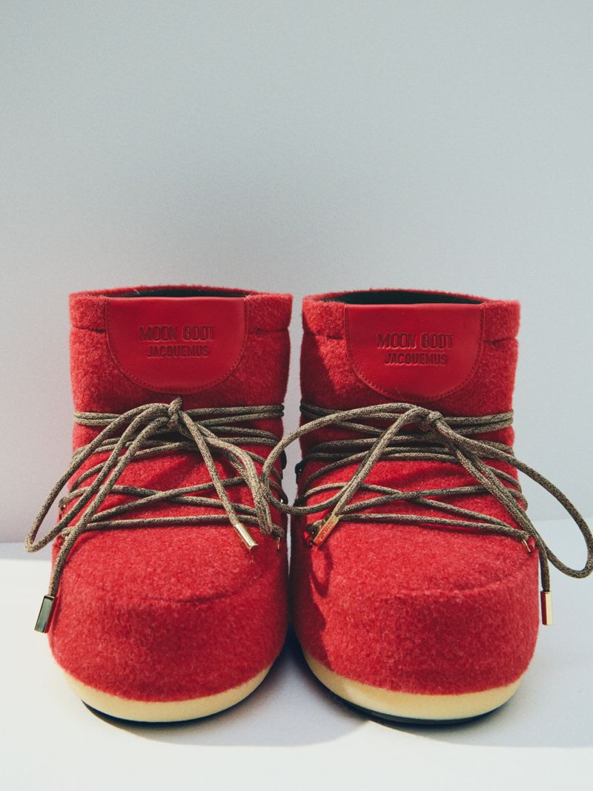
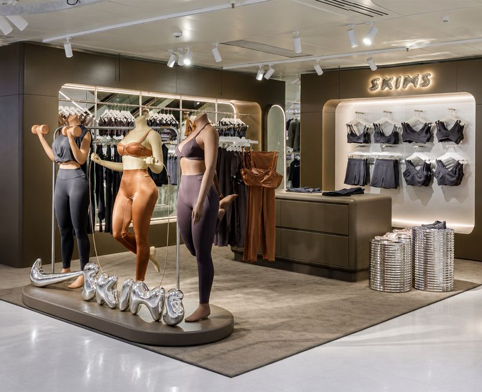

# Fashion news digest – 25 November 2026

## Top of the night

1. Vogue Business: SSENSE ties staff cuts to its switch to AI virtual try-on, and designers say inaccurate AI product images cost them sales.
2. Agentic commerce spreads: Meta's Muse launches in the UK with Debenhams, JD Sports, M&S and ASOS; Walmart opens Black Friday deals to Muse.
3. On X: Vogue Korea's Best Dressed 2026 (BTS post 171K views) and Jungkook's Chanel Beauty video (110K views within the hour) lead fashion talk.

## Fashion tech & AI

### 1. Vogue Business: SSENSE confirms a move to virtual try-on as designers count the cost of inaccurate AI product images (update)

A Vogue Business feature on fashion's growing problem with synthetic images adds new detail to the SSENSE case: the retailer told the outlet that June job changes in its visual content team were made to prepare for its move to AI virtual try-on (VTON), admitted recent imagery got product details wrong, and said it has tightened quality controls, without confirming AI caused the errors. Reese Cooper says the images showed his trademarked hook at twice its size and that pulling them also removed the items from sale, hurting his sell-through. A lawyer notes most wholesale agreements say nothing about AI-generated product imagery; the piece also covers the AI-faked Jensen Huang Saint Laurent jacket images.

**Why it matters for On-Model/PiktID:** The clearest statement yet of the buyer's fear On-Model must answer: garment and logo fidelity are a contractual and sell-through issue, not just aesthetics.

Sources: [vogue.com](https://www.vogue.com/article/the-year-fashion-fakes-became-too-real)

Influence score: 9/10 · Engagement seen: none visible · Published: 2026-11-24

_Note: Follow-up to the SSENSE item of 22 Nov: new SSENSE statement and designer/legal reaction. Article art includes photos of real people; not stored._

### 2. Meta's Muse shopping agent lands in the UK with Debenhams, JD Sports, M&S and ASOS, and gets Walmart's Black Friday deals in the US

Meta has launched its Muse personal agent in the UK with retail connector partners including Debenhams Group (Debenhams, boohoo, Karen Millen, PrettyLittleThing), JD Sports, M&S and ASOS; shoppers describe what they want, the agent searches and compares, and it checks out only after approval (FashionNetwork). In the US, Walmart now lets Muse users shop its Black Friday deals through its Agent Gateway, with spending limits, purchase approval and no access to shopping history (TechCrunch). TechCrunch notes Amazon has taken the opposite route, blocking third-party agents.

**Why it matters for On-Model/PiktID:** Agents now browse fashion catalogues on the shopper's behalf; product images and attributes must be accurate enough for a machine to choose and a human to approve.

[Full resolution](https://drive.google.com/file/d/1mocBEk3jf-kK7mzacpNsbK0xYBs9Vbcd/view) · image source: [techcrunch.com](https://techcrunch.com/wp-content/uploads/2026/11/muse-walmart.png) (internal reference only)

Sources: [fashionnetwork.com](https://ww.fashionnetwork.com/news/Debenhams-and-jd-sports-are-launch-partners-as-meta-s-muse-ai-agent-arrives-in-uk,1887683.html) · [techcrunch.com](https://techcrunch.com/2026/11/24/walmart-teams-up-with-meta-to-bring-black-friday-deals-to-ai-agent-muse/)

Influence score: 8/10 · Engagement seen: none visible · Published: 2026-11-24

_Note: Image credit: Walmart (via TechCrunch); shows hands only. Full-resolution file kept in its original WebP format._

### 8. Authentic Brands Group plugs its licensees into Genesys, an AI platform that lists products on 400+ marketplaces

Authentic Brands Group, owner of Reebok, Champion, Lucky Brand and Dockers, is partnering with Genesys so its 1,700+ licensees and partners can sell on more than 400 marketplaces in 190 countries through a single integration (Sourcing Journal). Genesys uses AI to automate listings, pricing, order processing and compliance; Authentic says an integration can go live within 24 hours and cut catalogue production costs. The deal follows Authentic's purchase of O'Neill's IP this week.

**Why it matters for On-Model/PiktID:** Licensee catalogues pushed to hundreds of marketplaces need on-model imagery at scale; a platform partner like Genesys is a natural integration target.

Sources: [wwd.com](https://wwd.com/sourcing-journal/industry-news/authentic-brands-group-genesys-ai-partnership-1239464339/)

Influence score: 6/10 · Engagement seen: none visible · Published: 2026-11-24

_Note: Article image is an event photo with people; not stored._

### 9. New ShellBench benchmark: top AI agents fail more than a third of everyday tasks people delegate to them

ShellBench, built by researchers from The OpenClaw Foundation, Parsewave, Hugging Face, Red Hat and UC Berkeley on more than 10 million anonymised agent interactions, found even the best models from OpenAI, Anthropic and Meta failed over a third of everyday tasks, and 15.7% of attempts broke at least one safety requirement (TechCrunch). Results were also inconsistent across repeated runs. It lands as Muse, Dots and Claude Duet are being pitched as shopping agents.

**Why it matters for On-Model/PiktID:** A counterweight to the agentic-commerce hype; brands will still need clean, accurate product data and images for agents to get purchases right.

Sources: [techcrunch.com](https://techcrunch.com/2026/11/24/even-the-best-ai-agents-struggle-with-everyday-life/)

Influence score: 6/10 · Engagement seen: none visible · Published: 2026-11-24

_Note: Article image not checked for people; not stored._

## E-commerce & retail business

### 5. Bangladesh unions reject a 15,700-taka wage offer as clashes continue; watchdog names Primark and Next supplier in union-busting report (update)

Worker representatives on Bangladesh's wage committee rejected employers' offer of a 15,700-taka (about EUR115) monthly minimum against a demand of 22,000 taka (about EUR160); the committee chair said the gap had narrowed, and workers blocking roads in Gazipur clashed with security forces (AFP via FashionNetwork). Separately, the Worker Rights Consortium published a report calling Libas Textiles, a Fresh Group knitwear factory in Gazipur, the decade's most severe case of union repression at a single Bangladeshi factory; it says the plant still produces for Aldi South, Next and Primark (Sourcing Journal).

Sources: [fashionnetwork.com](https://ww.fashionnetwork.com/news/Bangladesh-s-textile-unions-reject-employers-wage-increase-offer,1887861.html) · [wwd.com](https://wwd.com/sourcing-journal/sustainability/worker-rights-consortium-libas-textiles-primark-next-1239465329/)

Influence score: 7/10 · Engagement seen: none visible · Published: 2026-11-24

_Note: Update to the 24 Nov item on stalled wage talks: first figures from the negotiating table, plus the WRC report. News photos show protesters; not stored._

### 7. Abercrombie & Fitch posts a record third quarter and raises its holiday outlook

Abercrombie & Fitch Co. grew net sales 11% to $1.4 billion in the quarter to 31 October, with comparable sales up 6% and operating margin rising to 15.5% from 12% (FashionNetwork). Hollister grew 11% to $746.6 million and the Abercrombie brands 12% to $688.8 million; APAC sales rose 24%. The company now expects about 7% growth in the fourth quarter, citing fewer promotions and disciplined inventory.

Sources: [fashionnetwork.com](https://ww.fashionnetwork.com/news/Abercrombie-fitch-co-sees-net-sales-climb-11-to-1-4-billion-in-q3,1887818.html) · [wwd.com](https://wwd.com/business-news/retail/abercrombie-fitch-q3-raised-outlook-1239463752/)

Influence score: 6/10 · Engagement seen: none visible · Published: 2026-11-24

_Note: Article image shows models; not stored._

### 10. Kohl's returns to growth in Q3 on private labels, while Sephora shop-in-shops slip

Kohl's net sales rose 1.3% to $3.5 billion with comparable sales up 1.2%, net income jumped to $254 million and gross margin widened 145 basis points to 41% (Retail Dive). Proprietary brands and store improvements drove gains, but Sephora shop-in-shops fell nearly 2%; CEO Michael Bender defended the partnership as a traffic driver.

Sources: [retaildive.com](https://www.retaildive.com/news/kohls-turns-corner-q3-sephora-falls/875593/) · [fashionnetwork.com](https://ww.fashionnetwork.com/news/Kohl-s-returns-to-sales-growth-as-turnaround-gains-strength-in-q3,1887768.html)

Influence score: 5/10 · Engagement seen: none visible · Published: 2026-11-24

### 11. Retailers head into Black Friday wary of outages as AI speeds up the discovery of software flaws

After a run of lengthy outages at Microsoft, JPMorgan Chase, United Airlines, Apple and others, retailers are weighing the usual holiday code freeze against urgent patches for vulnerabilities that AI tools now find faster (Retail Dive). Gartner's Brad Jashinsky says most retailers avoid releases in this period but cannot wait when such a flaw appears; Gartner's CIO survey shows retail IT budgets up only 3.5%.

Sources: [retaildive.com](https://www.retaildive.com/news/black-friday-retailers-tech-outages-ai/875541/)

Influence score: 5/10 · Engagement seen: none visible · Published: 2026-11-24

_Note: Article image shows shoppers; not stored._

## Brands, launches & deals

### 4. Marc Jacobs made $509M in its last full year under LVMH, and most of the sale price went to repay LVMH loans

An SEC filing reported by WWD shows Marc Jacobs had 2025 revenue of $509 million, operating profit of $106.8 million and comprehensive income of $71.1 million. Of the roughly $900 million paid by G-III Apparel Group and WHP Global for the brand, $525 million went to repay loans owed to LVMH. Licensing brought in $32.1 million; the new owners plan to keep Marc Jacobs' runway shows, revive Marc by Marc Jacobs and expand licensing.

**Why it matters for On-Model/PiktID:** A licensing-led reset means more product categories and licensees producing content; scalable, consistent catalogue imagery becomes a licensing tool.

Sources: [wwd.com](https://wwd.com/business-news/financial/marc-jacobs-giii-whp-global-revenue-strategy-1239464631/)

Influence score: 7/10 · Engagement seen: none visible · Published: 2026-11-24

_Note: Article image is a backstage photo with people; not stored._

### 12. Jacquemus and Moon Boot release felt Icon Low boots today, their third collaboration

Jacquemus and Moon Boot release two felt versions of the Icon Low on 25 November, in 'Cardinal' red and 'Java' brown with beige felt laces and gold hardware, alongside earlier Icon Yeti and striped-felt styles (WWD/FN). They sell on Jacquemus.com, in Jacquemus stores, at selected retailers and on Moonboot.com; Moon Boot also dropped collaborations with Moncler Grenoble and Guest in Residence this month.

[Full resolution](https://drive.google.com/file/d/1mOb1OwHCZji8X_hvLID2QmNtaQC2YJ52/view) · image source: [wwd.com](https://wwd.com/wp-content/uploads/2026/11/JACQUEMUS-MOON-BOOTS_45_STILLS_1.jpg) (internal reference only)

Sources: [wwd.com](https://wwd.com/footwear-news/shoe-industry-news/jacquemus-moon-boot-icon-low-felt-release-date-1239464764/)

Influence score: 5/10 · Engagement seen: none visible · Published: 2026-11-24

_Note: Product still courtesy of Jacquemus (via WWD). The article's lead image includes a model and was not stored._

### 13. El Corte Inglés widens its Skims rollout and adds NikeSkims in Madrid and Barcelona

Spain's El Corte Inglés is adding the NikeSkims activewear line to its Castellana (Madrid) and Plaza de Cataluña (Barcelona) stores and online, after earlier Skims launches in Madrid's Serrano and Marbella; it is the line's exclusive multibrand stockist in Spain, alongside Nike's own stores (FashionNetwork). The range covers training, yoga, Pilates, outdoor and everyday pieces.

[Full resolution](https://drive.google.com/file/d/1g4Az8OQusL6WXyFIruvGXyscuaFnYDLE/view) · image source: [media.fashionnetwork.com](https://media.fashionnetwork.com/m/7717/8964/1818/446a/b094/aba8/aefe/7ff0/b0eb/05b6/05b6.png) (internal reference only)

Sources: [fashionnetwork.com](https://ww.fashionnetwork.com/news/El-corte-ingles-deepens-its-partnership-with-skims-launches-label-s-joint-collection-with-nike,1887765.html)

Influence score: 5/10 · Engagement seen: none visible · Published: 2026-11-24

_Note: Store image courtesy of El Corte Inglés (via FashionNetwork); mannequins only._

## Celebrity & red carpet

### 3. Vogue Korea's 'Best Dressed 2026' lists set off a wave of K-pop fashion posts on X

Vogue Korea published a set of 'Best Dressed 2026' stories on 24 November. Its 'Korean stars on the world stage' list includes G-Dragon at Coachella in a Chanel fall/winter 2026 fur coat by Matthieu Blazy, Jennie in a custom Ann Demeulemeester look at Lollapalooza Chicago, Rosé in a gold Saint Laurent spring 2027 look at the CFDA Awards, Jisoo in Dior at the Cruise 2027 show, Lisa in an Iris van Herpen 'Omen' look at Coachella, BTS's Paris tour outfits by six houses (Gucci, Dior, Balenciaga, Celine, Louis Vuitton, Givenchy), CORTIS, ILLIT's Wonhee in Chanel and TWICE's Sana in a minimal black Prada dress. Fan and news accounts pushed the picks across X overnight.

Sources: [vogue.co.kr](https://www.vogue.co.kr/2026/11/24/2026-%eb%b2%a0%ec%8a%a4%ed%8a%b8-%eb%93%9c%eb%a0%88%ec%84%9c-%ec%84%b8%ea%b3%84-%ec%86%8d-%ed%95%9c%ea%b5%ad-%ec%85%80%eb%9f%bd/) · [x.com](https://x.com/AboutMusicYT/status/2125161250183077974) · [x.com](https://x.com/AboutMusicYT/status/2125163766727737837) · [x.com](https://x.com/TheePopCore/status/2125173774370881818) · [x.com](https://x.com/TheePopCore/status/2125179730920185886)

Influence score: 8/10 · Engagement seen: x aboutmusicyt bts views: 171,161, x aboutmusicyt bts likes: 15,915, x aboutmusicyt wonhee views: 152,226, x theepopcore sana views: 51,737, x theepopcore jennie views: 40,734 · Published: 2026-11-24

_Note: No photos stored (real people)._

### 14. A Vanity Fair line about Taylor Swift's three pairs of Uggs turns into a footwear-and-class debate

In Vanity Fair's profile of Taylor Swift, a former schoolmate recalls Swift owning Ugg boots in brown, black and blue at a time when one pair cost half her own mother's paycheck. Footwear News (WWD) notes the remark sparked fan backlash, with some fans urging Ugg to sign Swift, and revisits 2003, when Ugg launched baby-blue and pink Classics at about $110-160 and Oprah's 'Favorite Things' list sent demand soaring.

Sources: [wwd.com](https://wwd.com/footwear-news/shoe-features/taylor-swift-ugg-boots-2000s-millennial-fashion-1239464654/)

Influence score: 5/10 · Engagement seen: none visible · Published: 2026-11-24

_Note: No photos stored (real people)._

## Social trends (X/TikTok)

### 6. Jungkook's Chanel Beauty video for Vogue Korea passes 100K views on X within an hour

Vogue Korea posted a sponsored Chanel Beauty feature with BTS's Jungkook, Chanel's global fragrance and beauty ambassador since December 2025, linking his look to Chanel's Les Exclusifs fragrance line. Within about an hour the magazine's post and several fan reposts of the video each passed 59,000 to 110,000 views, making it the top fashion-related content in our X searches.

Sources: [x.com](https://x.com/VogueKorea/status/2125405424409309535) · [x.com](https://x.com/dreamjeons/status/2125394507369767112) · [x.com](https://x.com/archiveforJK/status/2125395144744501304) · [koreatimes.co.kr](https://www.koreatimes.co.kr/entertainment/k-pop/20251212/bts-jung-kook-named-chanel-beautys-new-global-ambassador)

Influence score: 7/10 · Engagement seen: x voguekorea views: 59,474, x voguekorea likes: 8,788, x voguekorea reposts: 5,357, x dreamjeons views: 109,747, x dreamjeons likes: 11,294, x archiveforjk views: 92,487, x archiveforjk likes: 10,601 · Published: 2026-11-25

_Note: Verified via Vogue Korea's own post; ambassadorship from Korea Times (Dec 2025). No photos stored (real person)._

## TikTok search insights

- Creator Search Insights' keyword and content-gap view still isn't offered on TikTok web for this account, so no search-keyword or content-gap figures tonight. TikTok Studio > Inspiration > Trending (Beauty & Style, all regions) used instead; figures are the pairs shown (likely views / likes).

- #skincare #facemask (blackheads): 12M / 763K (as shown)
- #fashion #diy #tiktokawardsuk (creator nominated for TikTok Awards UK fashion creator of the year): 3.5M / 446K (as shown)
- #viral #fyp (transformation): 3M / 184K (as shown)
- #hairstyle: 1.9M / 23K (as shown)
- #hairstyle: 1.6M / 6.5K (as shown)
- #PeloMujer #CaidaDelPelo (women's hair loss): 1.4M / 32K (as shown)
- #barber transformation haircut: 1.1M / 158K (as shown)
- What a gentleman wears to meet her parents (menswear outfit): 1.1M / 90K (as shown)

- Gap On-Model could fill: the one fashion entry is again a DIY 'anything can be fashion' maker (a TikTok Awards UK nominee), plus a menswear 'what to wear' explainer. Quick flat-garment-to-outfit styling explainers are still missing from the trending set.

## Sources checked

- X: signed in. Searches for fashion (Top, 500+ likes), outfit/red carpet/Dior/Chanel/Prada/Gucci/Balenciaga/Vogue (Top, 3,000+ likes), AI fashion / virtual try-on / AI models / fashion tech / AI campaign / AI-generated (Top, 100+ likes; no fashion news, mostly generic AI-tool posts); Explore trending (Italy: only Ferragni, already covered yesterday).
- TikTok: signed in. Creator Search Insights searched (no tool entry on web); TikTok Studio Inspiration trending.
- TikTok Creator Search Insights: unavailable on web (keyword/gap view).
- News: The Interline (only The Edit podcast of 24 Nov, topics already covered or older), Vogue Business, Vogue Korea, TechCrunch, FashionNetwork, WWD / Sourcing Journal / Footwear News, Retail Dive, Modern Retail, Just Style, Glossy, Business of Fashion (paywalled; headlines). Not reached: FashionUnited (listing didn't load), Drapers, The Verge, Hypebeast, Highsnobiety. WebFetch isn't available in this run; all pages were opened in the browser.
- Not used: Daydream overnight shopping agent and Zalando Extended (17 Nov, older), Fermat $8M seed (18 Nov), Ross Stores outlook (20 Nov), ThredUp on TikTok Shop (20 Nov), Klarna Search & Compare expansion (minor), Dick's comments on Nike's Jordan reset, Balmain menswear (10 Nov), Vogue Japan / SixTONES award (music-led).
- Images: workspace network blocks direct downloads, so original files were fetched through the browser unchanged; 3 uploaded to the [Drive day folder](https://drive.google.com/drive/folders/1jAUrhZaU5IEEmaOdGATNOYrh4MeYdixU) and previewed here. No photos of real people stored (Vogue fakes art, Marc Jacobs, Bangladesh, Abercrombie, Authentic, Retail Dive, Jacquemus lead image, Vogue Korea, Jungkook, Taylor Swift skipped).

## Possible LinkedIn angles

- 'On a product page, plausible is misrepresentation' (Odunayo Ojo, Vogue Business). Fidelity, not realism, is the bar for AI product imagery.
- Most wholesale contracts don't mention AI product images yet. Brands should ask retailers how their imagery is made and who signs off on accuracy.
- Meta's Muse now shops ASOS, M&S, JD and Debenhams for UK users. When an agent picks for the shopper, the product image has to be right first time.
