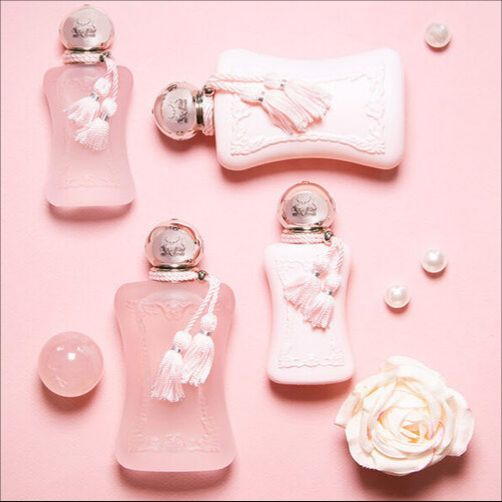

# Fashion news digest – 28 November 2026

_X and TikTok checked signed in; little fresh fashion news there on a US holiday night. TikTok Creator Search Insights not reachable. 9 items (no padding), 1 image preview; no Drive uploads tonight._

## Top of the night

1. US Black Friday heads for a record $13B+ online (Adobe), with full malls but no stampedes.
2. Bain: AI agents completed just 0.4% of global e-commerce transactions over Black Friday; shoppers use AI to search, not to pay.
3. The Interline on SSENSE: generative product imagery fails when it's a cost cut, works when it's a QA'd workflow.

## Fashion tech & AI

### 2. Bain: AI shopping agents handled just 0.4% of global e-commerce transactions over Black Friday

Purchases completed by AI agents made up only 0.4% of global online transactions (0.2% by value), Bain & Company said on 27 November, as reported by Seoul Economic Daily. More shoppers use AI to search (54% of US adults, up from 47%, in a Morning Consult survey for Visa), but only 23% trust it to buy and pay. Visa's test of 22 assistants found 42.8% failed, most often by buying something that did not match the request, and half of 200 big retail sites checked by Human Forward block agents such as ChatGPT, Gemini and Meta's Muse.

**Why it matters for On-Model/PiktID:** Agents are a discovery channel, not yet a checkout: the shopper still lands on the product page, and agents that pick the wrong item show why precise, accurate product imagery and attributes matter.

Sources: [en.sedaily.com](https://en.sedaily.com/world/2026/11/28/ai-shopping-agents-account-for-just-04-percent-of-sales-on)

Influence score: 8/10 · Engagement seen: none visible · Published: 2026-11-28

_Note: Lead image is a Reuters photo of shoppers; not stored._

### 3. The Interline on SSENSE: generative product imagery breaks the e-commerce promise when it's run as a cost cut

The Interline's weekly analysis uses the SSENSE case (designers Reese Cooper, Gerrit Jacob and Sage Toda-Nation flagged listing images that changed details, seams and silhouettes after SSENSE closed its studio) to argue the problem is strategy, not the technology. It notes SSENSE's 'virtual try-on' label really meant synthetic on-model photography, and that large retailers already use generated images successfully, with many UK shoppers seeing them without noticing. Its conclusion: workable generative image pipelines still need art direction, review and QA, and savings come from reusable workflows rather than from cutting people, citing Zalando and Photoroom as examples.

**Why it matters for On-Model/PiktID:** This is the clearest industry framing yet of On-Model's pitch: garment fidelity and QA, not just cheaper images; useful for outreach to retailers worried about the SSENSE backlash.

Sources: [www.theinterline.com](https://www.theinterline.com/2026/11/27/ssense-ai-product-imagery/)

Influence score: 8/10 · Engagement seen: none visible · Published: 2026-11-27 · **Update**

_Note: Update to the SSENSE story covered 22 and 25 Nov. Header image shows models; not stored._

## E-commerce & retail business

### 1. US Black Friday heads for a record $13B+ online as malls report full car parks but no stampedes

Adobe Analytics counted $9.7B in US online spending by 6:30 p.m. ET on Black Friday, up 12.8% on last year, and now expects a record $13.0-13.4B for the day, above its $12.9B forecast; Thanksgiving Day itself hit $7.1B (+10.4%). Salesforce puts US online sales at $5.9B for the first half of the day and forecasts $18.7B (+4%) on its own method. In stores, WWD heard of full parking lots and lines at Hollister, Abercrombie & Fitch, Skims, Aritzia, Ugg, Nike and The North Face, with Macy's discounting 40-70% and executives still tracking to mid-single-digit holiday growth. In the UK, Drapers reports more fashion brands opting out: 35% of small businesses are skipping Black Friday this year versus 22% in 2025 (MoneySuperMarket).

**Why it matters for On-Model/PiktID:** Record online volume at heavy discounts means PDP content has to be ready for peak traffic without extra shoot budget; the next test is Cyber Monday, projected at $15.1B.

Sources: [nglobenews.com](https://nglobenews.com/en/article/us-black-friday-online-sales-13-billion-adobe-2026-11-27) · [wwd.com](https://wwd.com/business-news/retail/black-friday-turnout-picks-up-as-the-day-progresses-1239467491/) · [www.drapersonline.com](https://www.drapersonline.com/news/the-fashion-retailers-rethinking-black-friday)

Influence score: 8/10 · Engagement seen: x trending: 'Black Friday' in X Explore trending (Italy) · Published: 2026-11-27

_Note: Adobe/Salesforce figures are preliminary, reported via N Global News; WWD store photo shows shoppers, not stored._

### 4. Zara, H&M, M&S and others moved about $254M of orders out of Bangladesh in early November, mostly to India

Three Bangladeshi factory owners told Reuters that brands including Zara, H&M, Marks & Spencer and Celio diverted around $254M of orders between 1 and 18 November, close to a tenth of monthly volume, as wage protests disrupted output. The BGMEA puts production losses above $400M; Vietnam, Cambodia and Indonesia are also gaining. Indian textile stocks rallied on the report, with Gokaldas Exports up as much as 11%. Inditex declined to comment; M&S, H&M and Celio did not respond.

Sources: [www.investing.com](https://www.investing.com/news/stock-market-news/exclusiveglobal-fashion-brands-shift-orders-from-bangladesh-to-india-amid-unrest-5053435) · [www.businessoffashion.com](https://www.businessoffashion.com/news/global-markets/global-brands-shift-250-million-in-orders-from-bangladesh-amid-unrest/)

Influence score: 7/10 · Engagement seen: none visible · Published: 2026-11-27 · **Update**

_Note: Update to the Bangladesh wage story (25-26 Nov). Images show workers; not stored._

### 9. France's Bill No. 2824 would curb model debt to agencies and force action on harassment

A cross-party bill tabled in May by MPs Erwan Balanant and Sandrine Rousseau, still awaiting a parliamentary slot, would bring modelling agencies under labour-code limits on deductions from pay, targeting the practice of advancing travel, housing and portfolio costs and then recovering them from earnings (FashionNetwork). It would also require agencies to open internal investigations into harassment claims and, with the model's consent, file complaints. It follows Kering and LVMH's updated model charter.

**Why it matters for On-Model/PiktID:** Tighter rules and costs around human model shoots are part of the backdrop to brands weighing AI and licensed digital models; worth tracking, not overselling.

Sources: [uk.fashionnetwork.com](https://uk.fashionnetwork.com/news/Bill-no-2824-the-legislation-that-could-upend-france-s-modelling-industry,1888767.html)

Influence score: 4/10 · Engagement seen: none visible · Published: 2026-11-27

_Note: Header image not checked; not stored._

## Brands, launches & deals

### 5. Zara x kolor 'World Uniform' capsule lands 3 December, with kolor's first kidswear

Zara has teamed up with Tokyo label kolor, now led by creative director Taro Horiuchi, on a women's, men's and children's capsule called 'World Uniform', on sale from 3 December online and in selected stores, plus concept spaces in Milan and New York. The pieces rework uniforms, workwear and tailoring: a beige-and-khaki hybrid trench, a leather-look military jacket patched with pinstripe, an offset-collar black and purple cardigan and paint-splattered double-knee work pants. Fashion Press's post on X drew about 765K views; X's auto-translation rendered the brand as 'KHAITE'.

**Why it matters for On-Model/PiktID:** Zara's designer-collab cadence (Galliano, Chavarria, now kolor) needs consistent on-model content across markets on launch day, including kidswear.

Sources: [uk.fashionnetwork.com](https://uk.fashionnetwork.com/news/Zara-joins-forces-with-japanese-brand-kolor-for-new-collection,1888850.html) · [www.fashion-press.net](https://www.fashion-press.net/news/153981) · [www.vogue.com](https://www.vogue.com/article/the-scoop-with-kolors-taro-horiuchi-on-his-zara-collab) · [x.com](https://x.com/fashionpressnet/status/2126269827807588697)

Influence score: 7/10 · Engagement seen: X views: 765,867, X likes: 6,792, X reposts: 990, X bookmarks: 1,807 · Published: 2026-11-27

_Note: Campaign images show models; not stored._

### 6. Puig buys 75% of Parfums de Marly and Initio owner Artessence for about €1.2B

Puig will acquire 75% of Paris-based Artessence Group from Advent International and founder Julien Sprecher, valuing the whole company at about $1.9B enterprise value; Sprecher keeps 25%, with options that let Puig reach 100% over time. Artessence expects $420-440M revenue and $180-190M EBITDA this financial year. The niche brands join Byredo and Penhaligon's in Puig's artistic-fragrance portfolio; closing is expected in Q2 2027.

Full resolution: not uploaded to Drive tonight; original: [media.fashionnetwork.com](https://media.fashionnetwork.com/m/06db/1000/db41/3d83/7584/ab9f/f6a5/12e5/ae02/6738/6738.jpg) (502×502 preview from browser capture)

Sources: [uk.fashionnetwork.com](https://uk.fashionnetwork.com/news/Puig-acquires-75-of-artessence-for-1-2-billion-euros,1889018.html) · [www.businessoffashion.com](https://www.businessoffashion.com/articles/beauty/puig-agrees-to-acquire-parfums-de-marly-and-initio-parfums-prives-for-12-billion/) · [wwd.com](https://wwd.com/beauty-industry-news/fragrance/puig-acquire-75-percent-parfums-de-marly-initio-1-2-billion-1239467775/)

Influence score: 7/10 · Engagement seen: none visible · Published: 2026-11-28

## Celebrity & red carpet

### 8. Jennifer Lopez's CBS Thanksgiving special turns into a showgirl wardrobe parade

For 'The JLo Show: Live in Las Vegas' on CBS, stylists Rob Zangardi and Mariel Haenn dressed Lopez in looks by Charbel Zoé, The Blonds and Victoria's Secret's Adam Selman (WWD). She opened in Charbel Zoé cobalt blue: a sheer, crystal-embellished high-neck gown with a feathered bolero, then a beaded mesh cut-out bodysuit with a cancan skirt and pale-blue tulle petticoat, fishnets and crystal lace-up boots. Later came a blush feather-trimmed robe over lingerie-style pieces, a custom fuchsia-purple illusion-neck gown by The Blonds with embellished opera gloves and an Atelier Biser boa, and an early-2000s callback in a cropped jacket and fringed low-rise mini.

Sources: [wwd.com](https://wwd.com/pop-culture/celebrity-news/jennifer-lopez-thanksgiving-special-outfits-2026-1239467554/)

Influence score: 5/10 · Engagement seen: none visible · Published: 2026-11-27

_Note: Celebrity item: outfit described in words, no image stored._

## Social trends (X/TikTok)

### 7. Netflix's 'The Body' keeps Y2K costume talk going on X, with designer moodboards passing 95K views

A fan post sharing costume designer Mirren Gordon-Crozier's character moodboards (via i-D) for Elise, Anya and Lisbeth gathered about 6.9K likes and 95K views on X within hours. Set in 2004, the hit Netflix series dresses its cheer squad in rhinestones, velour tracksuits, fur-trimmed leather and pedal pushers; Gordon-Crozier told Dazed she built a separate board per character, drawing on early-2000s Blumarine, Marc Jacobs and Chloé. Vogue Business is also running a piece on the show and the teen-drama fashion machine.

**Why it matters for On-Model/PiktID:** Screen-driven Y2K demand is a quick-turn merchandising cue; brands chasing it need fast styled imagery for revived silhouettes.

Sources: [x.com](https://x.com/saintdemie/status/2126383627990917124) · [www.dazeddigital.com](https://www.dazeddigital.com/fashion/article/71388/1/the-body-netflix-costume-design-mirren-gordon-crozier-interview-y2k-fashion) · [www.vogue.com](https://www.vogue.com/article/the-body-and-the-teen-drama-fashion-machine)

Influence score: 6/10 · Engagement seen: X views: 95,241, X likes: 6,966, X reposts: 891, X bookmarks: 1,111 · Published: 2026-11-27

_Note: Images show actors; not stored. The show's #1 Netflix ranking was reported by Dazed on 19 Nov._

## TikTok search insights

- TikTok Creator Search Insights: unavailable. On the web, searching for it returns an AI summary and tutorial videos, not the tool (no 'View' entry), so no trending keywords or content-gap searches tonight.
- Content-gap line: none to report without the tool's data.

## Sources checked

- x.com (signed in: Explore trending (Italy); searches 'fashion since:2026-11-27 min_faves:2000' (Top), AI fashion / virtual try-on / AI model / fashion tech (Top), 'Valentino' trend (not fashion: MotoGP))
- tiktok.com (signed in: search 'zara khaite/kolor'; nothing new in window with meaningful reach)
- TikTok Creator Search Insights: unavailable (searching it on web shows only an AI summary and tutorial videos, not the tool)
- theinterline.com (weekly analysis 27 Nov)
- businessoffashion.com (headlines; paywalled)
- vogue.com / Vogue Business (headlines; paywalled)
- wwd.com
- uk.fashionnetwork.com
- drapersonline.com
- retaildive.com (nothing new in window)
- retailtechinnovationhub.com (nothing fashion-specific new)
- hypebeast.com
- fashion-press.net
- dazeddigital.com
- en.sedaily.com
- nglobenews.com
- investing.com (Reuters)
- WebSearch (Just Style, Sourcing Journal, TechCrunch, The Verge, AI fashion funding: nothing new in window)
- Not reached: highsnobiety.com, modernretail.co (time)
- Google Drive: folder reachable; no uploads tonight (original image files could not be moved from the browser into the workspace)
- Left out: Y-3 x Jeff Hamilton Kimi Antonelli jacket (26 Nov, before window), Etsy AI-terms exodus (18 Nov), Artiso and Fermat funding (early/mid Nov), Burberry V&A tree (24 Nov), Meta Muse at Sainsbury's (grocery), Moncler x Rick Owens (covered 27 Nov).

## Possible LinkedIn angles

- 0.4%: AI agents' share of Black Friday transactions (Bain). AI finds the product; the product page, and its images, still close the sale.
- The Interline on SSENSE: the problem isn't generative imagery, it's treating it as a cost cut. Fidelity and QA are the product.
- Zara x kolor drops 3 Dec across markets and kidswear. Designer collabs live or die on launch-day content consistency.
