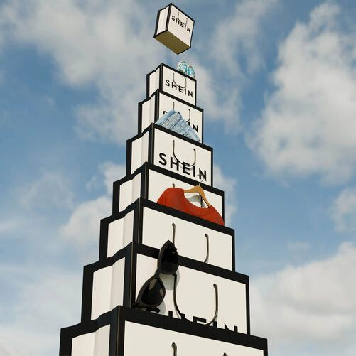

# Fashion news digest – 27 November 2026

_X and TikTok were checked signed in but produced little fresh fashion news; TikTok Creator Search Insights was not reachable. 11 items, 3 images._

## Top of the night

1. Temu signs a binding EU commitment to verify reviews, label genuine discounts and drop gamified pressure selling.
2. Shein's India relaunch with Reliance stalls at ~6M monthly users, and Shein agrees a $100M FTC settlement in the US.
3. Voyado: 48% of Europeans will use AI to find Black Friday deals, but most still check price, fit and delivery on the retailer's site before buying.

## Fashion tech & AI

### 3. Voyado survey: 48% of European shoppers will use AI to hunt Black Friday deals, but only a third will let it place the order

Retail-tech firm Voyado says 48% of European shoppers expect to use AI assistants to find prices or offers during Black Friday and the holiday period, and 38% for gift ideas. Trust stops short of the wallet: 51% are not at all comfortable sharing card details with an assistant, and only 33% are comfortable with AI placing an order even after approving item and price. Before buying an AI-recommended product, 64% want to check the total price on the retailer's site, 42% the product details and fit, and 40% the delivery date; search engines (27%) still lead as a starting point, with AI assistants (18%) level with retailer sites and apps (17%).

**Why it matters for On-Model/PiktID:** AI gets the product shortlisted, but the product page closes the sale: shoppers go to the PDP to check fit and details, where on-model imagery does the work.

Sources: [uk.fashionnetwork.com](https://uk.fashionnetwork.com/news/Shoppers-use-ai-to-find-black-friday-bargains-but-a-brand-s-or-retailer-s-webstore-clinches-the-deal-report,1888383.html)

Influence score: 7/10 · Engagement seen: none visible · Published: 2026-11-25

_Note: Lead image shows a person; not stored._

### 5. Gap Inc. puts Cognition's Devin coding agent on Black Friday duty to find and fix site issues

Gap Inc. is using Devin, the AI software-engineering agent from Cognition, to keep its e-commerce sites running through Black Friday and Cyber Week (RTIH). In a 'site scan' process Devin watches for signs of customer struggle or system faults, investigates root causes and writes tested code fixes that engineers review and publish. Gap says it logged more than 75 million online sessions and over 5 million orders in last year's nine-day holiday window, peaking above 1,500 orders a minute, and estimates Devin has already recovered millions in sales otherwise lost to downtime.

**Why it matters for On-Model/PiktID:** A large apparel group is putting AI agents into production e-commerce operations, not just marketing; buyers are getting comfortable with agentic tools in the core stack.

Sources: [retailtechinnovationhub.com](https://retailtechinnovationhub.com/home/2026/11/26/gap-inc-taps-cognitions-devin-ai-tool-to-help-keep-holiday-shopping-running-smoothly)

Influence score: 6/10 · Engagement seen: none visible · Published: 2026-11-26

_Note: Lead image is a campaign photo with people; not stored._

### 10. India's Fynd lands its first big UK retail client, N Brown, for AI-built integration platform Boltic

Fynd, an AI-native retail-tech company from India, will supply its Boltic workflow-automation and integration (iPaaS) platform to N Brown, owner of JD Williams, Simply Be and Jacamo (RTIH). Roll-out starts at Ambrose Wilson and then moves across the group's other brands as part of N Brown's technology modernisation.

**Why it matters for On-Model/PiktID:** Mid-market fashion groups are rebuilding their data plumbing; clean product data flows are what make automated image production plug in.

Sources: [retailtechinnovationhub.com](https://retailtechinnovationhub.com/home/2026/11/25/indian-ai-specialist-fynd-bags-first-major-retail-customer-win-in-the-uk-as-n-brown-comes-onboard)

Influence score: 4/10 · Engagement seen: none visible · Published: 2026-11-25

_Note: Lead image not checked for people; not stored._

### 11. The Interline: after a shakeout, fashion's impact-assessment tools are consolidating around science-based platforms

In a new podcast episode with Carbonfact's Laurent, The Interline's Ben Hanson argues that sustainability-tech demand stalled as EU rules ended up softer than expected and shopper behaviour did not change, leading to market consolidation. The vendors left are data-centric platforms with clear methodologies; Carbonfact says its numbers are used mainly to guide internal decisions, with consumer-facing disclosure as a second use, and stresses water, chemicals and land use alongside carbon.

Sources: [www.theinterline.com](https://www.theinterline.com/2026/11/26/the-science-of-fashion-impact-assessment-and-the-market-value-of-disclosure/)

Influence score: 4/10 · Engagement seen: none visible · Published: 2026-11-26

_Note: Header image is a guest portrait; not stored. Guest surname not shown in the text read._

## E-commerce & retail business

### 1. Temu signs binding EU pledge to screen fake reviews, label real discounts and drop its spin-the-wheel gamification

The European Commission said the EU network of consumer protection authorities (CPC) has accepted binding commitments from Temu after complaints dating back to November 2024. Reviews will be checked for authenticity before publication with a fake-review detection system, price displays must separate genuine discounts from comparisons with a reference price, and all taxes and fees must be shown before checkout. Refunds are to be processed within 14 days, the cancellation form will be available in all EU languages, and mandatory game-like elements such as the entry 'wheel of fortune' are being removed. Separate Digital Services Act cases continue, including the €200M fine over illegal products.

**Why it matters for On-Model/PiktID:** Tighter EU rules on reviews and 'real' discounts raise the bar for honest product presentation on marketplaces; accurate product imagery is part of the same trust agenda.

[Full resolution](https://drive.google.com/file/d/1OdZjd1Hw8NB7OpCUwHsM8JUqecHRnwh0/view) · image source: [media.fashionnetwork.com](https://media.fashionnetwork.com/m/833d/f09b/598d/3873/985d/43af/9f2c/edad/c580/429c/429c.jpg) (internal reference only)

Sources: [uk.fashionnetwork.com](https://uk.fashionnetwork.com/news/Temu-backs-down-pledges-greater-transparency-on-prices-and-reviews,1888704.html) · [fashionunited.uk](https://fashionunited.uk/news/business/temu-agrees-to-end-fake-reviews-and-misleading-discounts-under-eu-pressure/2026112691592)

Influence score: 7/10 · Engagement seen: none visible · Published: 2026-11-26

_Note: Image: Temu app illustration via FashionNetwork (credit as on source). FashionUnited version is paywalled; facts taken from FashionNetwork (dpa translation)._

### 2. Shein's India comeback with Reliance stalls at about 6M monthly users, as Shein also agrees a $100M FTC settlement in the US

Bloomberg reports (via FashionNetwork and BoF) that Shein's February 2025 relaunch in India through Mukesh Ambani's Reliance Retail is struggling: Sensor Tower estimates about 6 million monthly active users in October, roughly flat since January, against about 100 million for Walmart-owned Myntra. Reliance runs the operation and has not received Shein's proprietary design-to-production technology, so it built vendor and production processes from scratch with smaller Indian manufacturers, causing extra training, waste and slower turnaround. Separately, Shein will pay $100M under a proposed FTC order over alleged broken fast-shipping promises, suppressed critical reviews and unsupported cotton-sourcing and audit claims; Shein does not admit liability.

**Why it matters for On-Model/PiktID:** Shows that Shein's edge is its speed-to-market tech stack, not the brand; fast, cheap content creation is part of that loop.

[Full resolution](https://drive.google.com/file/d/1LJJgLIyUyr3ohCzCtb2gL99XmpG8CV-w/view) · image source: [media.fashionnetwork.com](https://media.fashionnetwork.com/m/6f31/d010/e0af/cff8/0f6f/2306/ffb0/61bd/2bca/8386/8386.jpg) (internal reference only)

Sources: [ww.fashionnetwork.com](https://ww.fashionnetwork.com/news/Shein-s-slow-india-start-lays-bare-limits-of-billionaire-ambani-s-retail-might,1888427.html) · [www.businessoffashion.com](https://www.businessoffashion.com/news/retail/sheins-return-to-india-struggles-to-recapture-its-former-glory/) · [www.retaildive.com](https://www.retaildive.com/news/shein-to-pay-100m-in-ftc-settlement-over-deceptive-practices-claims/875748/)

Influence score: 7/10 · Engagement seen: none visible · Published: 2026-11-26

_Note: The FTC settlement was announced on 24 Nov (Retail Dive, 25 Nov) and was not in earlier digests. Image: Shein shopping-bag tower illustration via FashionNetwork._

### 7. Urbn posts record Q3 sales of $1.67B, led by Free People and Urban Outfitters

Urbn, owner of Urban Outfitters, Free People and Anthropologie, grew net sales 8.9% to a record $1.67 billion in the quarter to 31 October, with net income up 15% to $134.1 million (Drapers). Comparable retail sales rose 8.5% at Free People, 5.8% at Urban Outfitters and 1.7% at Anthropologie. Nine-month sales rose 10.2% to $4.81 billion and net income 33% to $490 million.

Sources: [www.drapersonline.com](https://www.drapersonline.com/news/urban-outfitters-hails-record-third-quarter-sales)

Influence score: 6/10 · Engagement seen: none visible · Published: 2026-11-26

_Note: No image stored._

### 9. Storms push Macy's 100th Thanksgiving Day Parade to Saturday 28 November

Macy's moved its 100th Thanksgiving Day Parade in New York from Thursday to Saturday 28 November at 8:30 a.m. ET because of severe storms across the Northeast (Retail Dive). The parade, which began in 1924, has only been paused once before (1942-44, during the war); the centenary edition took about five years to plan and comes with a line of limited-edition parade merchandise and brand collaborations. Macy's Inc. reports Q3 results on 2 December.

Sources: [www.retaildive.com](https://www.retaildive.com/news/macys-100th-thanksgiving-day-parade-postponed/875808/)

Influence score: 5/10 · Engagement seen: none visible · Published: 2026-11-25

_Note: Lead image shows identifiable parade participants; not stored._

## Brands, launches & deals

### 6. Zegna Group starts production at its new footwear and leather goods plant near Parma for Zegna, Thom Browne and Tom Ford Fashion

The Ermenegildo Zegna Group has begun operations at a footwear and leather goods centre in Sala Baganza, near Parma, that will make products for all three of its brands and grow to more than 300 employees (WWD, FashionUnited). First announced in February 2024, the site was designed by Antonio Citterio Patricia Viel, is ringed by 400 trees and has a 1.3 MWp solar installation; its formal inauguration is planned for the first half of 2027. It extends a vertically integrated chain that already includes Lanificio Zegna, Tessitura di Novara, Bonotto and Dondi.

[Full resolution](https://drive.google.com/file/d/1WThhSnNZn6ju-xWsjgUpNa6X5Uf1YcrI/view) · image source: [wwd.com](https://wwd.com/wp-content/uploads/2026/11/PHOTO-2026-11-26-12-06-49.jpg) (internal reference only)

Sources: [wwd.com](https://wwd.com/business-news/business-features/ermenegildo-zegna-group-new-footwear-leather-goods-plant-1239466752/) · [fashionunited.uk](https://fashionunited.uk/news/business/zegna-bets-on-made-in-italy-with-new-footwear-and-leather-goods-facility/2026112691593)

Influence score: 6/10 · Engagement seen: none visible · Published: 2026-11-26

_Note: Image: exterior of the Parma plant, via WWD (credit as on source)._

### 8. Moncler and Rick Owens return with a studded, Geo-quilted FW26 outerwear collection

Moncler x Rick Owens Fall/Winter 2026 centres on quilted outerwear with a graphic 'Geo Quilting' pattern, metal studs, oversized Tour pockets and a 'Mega Strap' for carrying a jacket across the body (Hypebeast). The palette is black, metallic Palladium, Cloud Grey and a muted 'Grease' tone, styled with Thyra sunglasses and Trailgrip Pentalace boots. Owens shot the campaign himself, casting Warhol-era film actor Joe Dallesandro; the collection is sold via HBX, Moncler and Rick Owens stores and online.

Sources: [hypebeast.com](https://hypebeast.com/2026/11/moncler-rick-owens-fall-winter-fw-2026-collaboration-collection-release-info)

Influence score: 6/10 · Engagement seen: none visible · Published: 2026-11-26

_Note: Release date not given in the source. Campaign images feature a real person; not stored._

## Celebrity & red carpet

### 4. Louis Vuitton turns its Shanghai 'ship' into a concert hall for Yuja Wang; livestream nears 100M views, Jackson Wang's post tops 200K

Pianist and LV ambassador Yuja Wang played Brahms's Piano Concerto No. 2 with the Mahler Chamber Orchestra inside a glass sphere next to The Louis, the brand's boat-shaped landmark in Shanghai, the first classical concert held there (WWD). Guests included Hélène Mercier-Arnault, Pietro Beccari and ambassadors Jackson Wang, Liu Yifei and Ouyang Nana; the 1.5-hour livestream on WeChat, Xiaohongshu, Weibo and state media was approaching 100 million views at publication. Wang performed in an emerald-green minidress with Christian Louboutin stilettos. On X, Jackson Wang's 'Tonight' post tagging Louis Vuitton passed 201K views and 13K likes.

Sources: [wwd.com](https://wwd.com/fashion-news/designer-luxury/louis-vuitton-the-louis-yuja-wang-concert-1239467077/) · [x.com](https://x.com/JacksonWang852/status/2125896324956787008)

Influence score: 7/10 · Engagement seen: x views: 201,000, x likes: 13,000, x reposts: 5,700, x replies: 2,100, livestream views reported: almost 100 million (WWD) · Published: 2026-11-26

_Note: Event photos show real people; described in words, no image stored._

## Social trends (X/TikTok)

_No qualifying items tonight._

## TikTok search insights

- TikTok Creator Search Insights: unavailable. On the web, tiktok.com/csi redirects to the For You feed for this account, so no trending keywords or content-gap searches tonight.
- Regular TikTok searches ('fashion news', 'AI fashion') showed mostly older videos; AI fashion content is dominated by how-to and tool-promo clips rather than news.

## Sources checked

- x.com (signed in: Explore trending (Italy); searches 'fashion since:2026-11-26' (Top), AI fashion / virtual try-on / AI model fashion (Top), 'outfit min_faves:5000' (Top); few fresh fashion-news posts)
- tiktok.com (signed in: searches 'fashion news', 'AI fashion'; nothing new in window with meaningful reach)
- TikTok Creator Search Insights: unavailable (tiktok.com/csi redirects to the home feed on web)
- theinterline.com (podcast of 26 Nov)
- businessoffashion.com (headlines/descriptions; paywalled)
- vogue.com / Vogue Business
- wwd.com
- fashionunited.uk (listing; articles paywalled)
- fashionnetwork.com
- drapersonline.com
- retaildive.com
- modernretail.co (nothing new in window)
- retailtechinnovationhub.com
- hypebeast.com
- semafor.com
- WebSearch (just-style, Sourcing Journal, TechCrunch, The Verge: nothing new in window)
- Not reached: highsnobiety.com (time)
- Google Drive: day folder 2026/11-27 created, 3 original images uploaded
- Images: originals fetched through the browser unchanged; 3 uploaded to the [Drive day folder](https://drive.google.com/drive/folders/13m6g3TYi4WSSEpyYIwRBswHlhmPG3Zot) and previewed here. No photos of real people stored (LV concert, Voyado, Gap, Moncler campaign, Macy's parade, Interline header skipped).
- Left out: Vogue Business 'year fashion fakes became too real' (SSENSE story already covered 25 Nov), Semafor AI pricing/outages (covered 24-25 Nov), Lumoo/Lovable case study (2025), Nike Gyakusou (covered 23 Nov), Teyana Taylor Actor Awards clip (older event).

## Possible LinkedIn angles

- Two-thirds of shoppers check details on the retailer's site before buying what an AI recommended (Voyado). The agent finds you; the product page still has to convince.
- Temu is now bound to verify reviews and label real discounts in the EU. Next step for trust: product images that show the actual garment, not a plausible one.
- Shein without its in-house speed engine is just another app: in India it sits at ~6M users vs Myntra's ~100M. Speed-to-shelf tooling, content included, is the moat.
